# A8 - Gearbox Design

## Objective

The objective of this assignment was to design a functional, two-part gearbox in SOLIDWORKS. The gearbox needed to support two meshing spur gears, transmit the specified torque and speed, allow the shafts to rotate inside journal bearings and be assembled and disassembled. I also evaluated the shaft diameters and bearing requirements before building the CAD assembly.

For MEGR 2157, I prepared engineering drawing sheets for the assembly and individual components.

### Design Requirements

| Parameter | Input (Pinion) | Output (Gear) |
| --- | ---: | ---: |
| Number of gear teeth | 18 | 48 |
| Pitch diameter | 0.375 in | 1.000 in |
| Shaft diameter | 0.125 in | 0.250 in |
| Shaft length | 1.000 in | 1.000 in |
| Rotational speed | 2,933.33 rpm (calculated) | 1,100 rpm (specified) |
| Torque | 0.46875 in-lbf (calculated) | 1.25 in-lbf (specified) |

The gear train was assumed to be ideal for the calculations. I used a 20-degree pressure angle for the gear-force analysis. The gears were selected from McMaster-Carr and the shafts were modeled separately so the gear hubs could be represented as press-fit connections.

## Analyze

### Gear Ratio and Shaft Loading

I began with the specified output torque and speed, then used the 18-tooth pinion and 48-tooth output gear to determine the input conditions. The calculated gear ratio was approximately **2.667:1**, with the input shaft rotating faster and carrying less torque than the output shaft.

The shaft calculations were completed by hand, including the known values, free-body diagrams, torque relationships, maximum torsional shear stresses and estimated minimum shaft diameters.

### Input Shaft Design

The input shaft has a specified diameter of **0.125 in** and a length of **1.000 in**. I calculated the input speed and torque from the gear ratio, then checked the resulting torsional stress against the allowable shear stress used in my calculations.

<figure>
  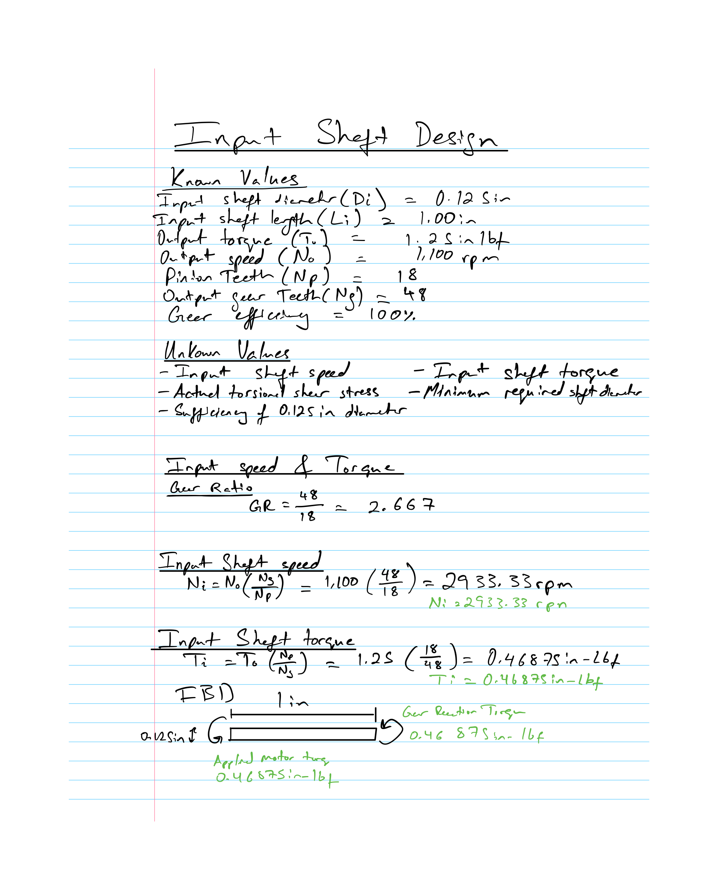
  <figcaption>Figure 1. Input shaft requirements, gear ratio, calculated speed and torque and free-body diagram.</figcaption>
</figure>

<figure>
  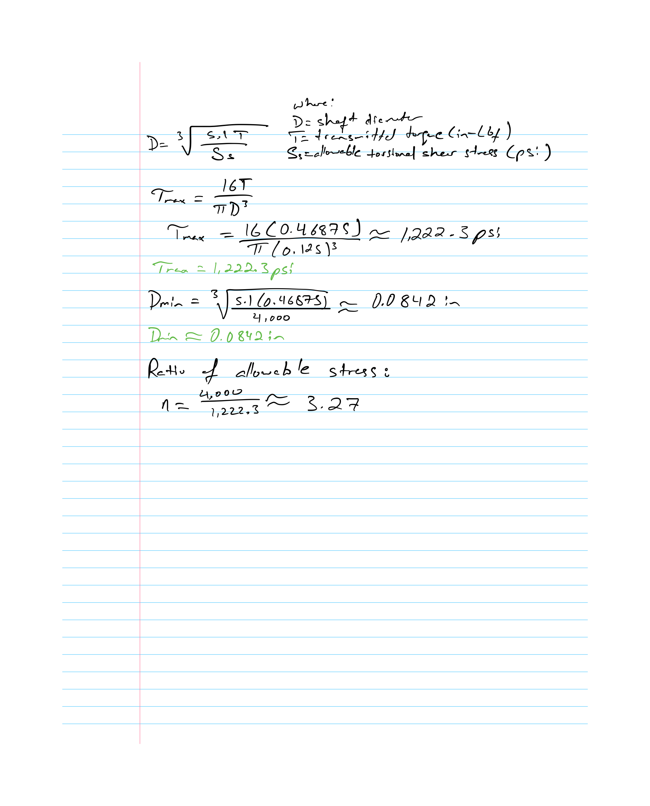
  <figcaption>Figure 2. Input shaft stress calculation and diameter adequacy check.</figcaption>
</figure>

My calculations gave a maximum torsional shear stress of approximately **1,222.3 psi** and a minimum required diameter of approximately **0.0842 in**, using the stated allowable stress of **4,000 psi**. The calculated allowable-stress-to-actual-stress ratio was approximately **3.27**. Under these torsional loading assumptions, I concluded that the specified 0.125-inch diameter was sufficient.

### Output Shaft Design

The output shaft has a specified diameter of **0.250 in** and a length of **1.000 in**. Because the output torque and speed were already given, I used those values to check the torsional stress and minimum diameter.

<figure>
  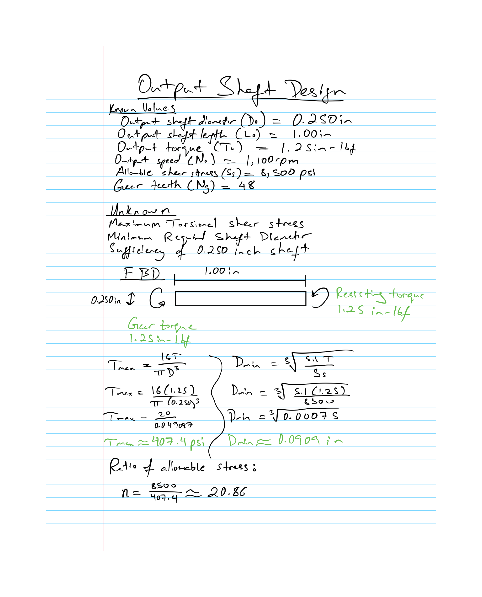
  <figcaption>Figure 3. Output shaft loading, torsional stress and diameter adequacy check.</figcaption>
</figure>

The output-shaft calculation produced approximately **407.4 psi** maximum torsional shear stress and a minimum required diameter of approximately **0.0909 in**, using an allowable stress of **8,500 psi**. The allowable-stress-to-actual-stress ratio was approximately **20.86**. I retained the specified 0.250-inch output shaft for the CAD model.

### Journal Bearing Design

The shafts need to rotate inside stationary journal bearings. To evaluate bearing suitability, I considered the tangential and radial forces from the gear mesh and used the resulting load in the bearing-pressure, surface-velocity and PV calculations.

<figure>
  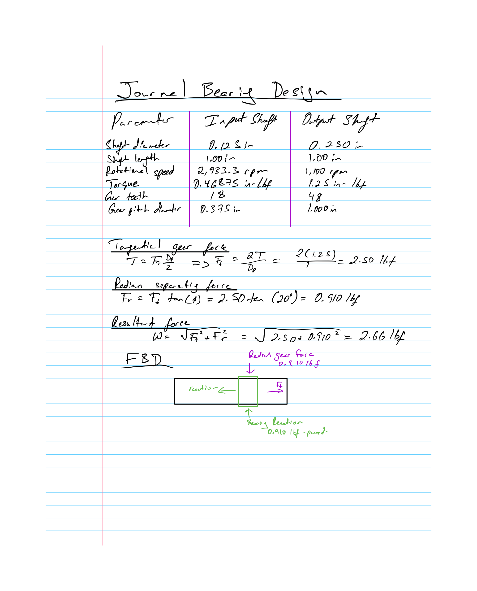
  <figcaption>Figure 4. Bearing design parameters and gear-force analysis, including the free-body diagram.</figcaption>
</figure>

The calculated tangential gear force was approximately **2.50 lbf** and the radial separating force was approximately **0.910 lbf**. I used a resultant force of approximately **2.66 lbf** for the bearing sizing calculations.

<figure>
  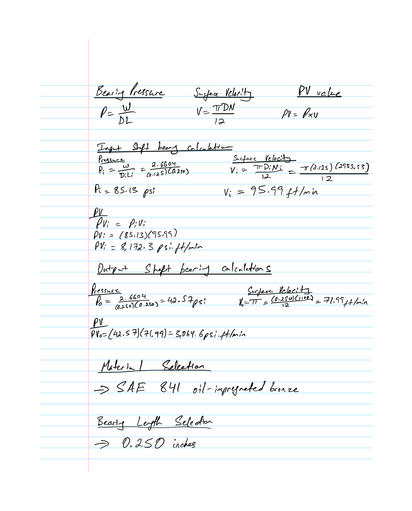
  <figcaption>Figure 5. Input and output bearing pressure, surface velocity and PV calculations.</figcaption>
</figure>

| Calculated bearing quantity | Input bearing | Output bearing |
| --- | ---: | ---: |
| Bearing length used in calculations | 0.250 in | 0.250 in |
| Bearing pressure | 85.13 psi | 42.57 psi |
| Surface velocity | 95.99 ft/min | 71.99 ft/min |
| PV value | 8,172.3 psi-ft/min | 3,064.6 psi-ft/min |

I used **SAE 841 oil-impregnated bronze** as the selected bearing-material basis in my calculations. The PV values were used as part of the selection process; actual catalog limits and fit tolerances would still need to be confirmed for manufacturing.

### Journal Bearing Wall Thickness

I then checked the bearing wall thickness using the internal-pressure and hoop-stress approach shown in my handwritten work. I compared the estimated minimum thicknesses with the actual wall thicknesses of the selected sleeve bearings.

<figure>
  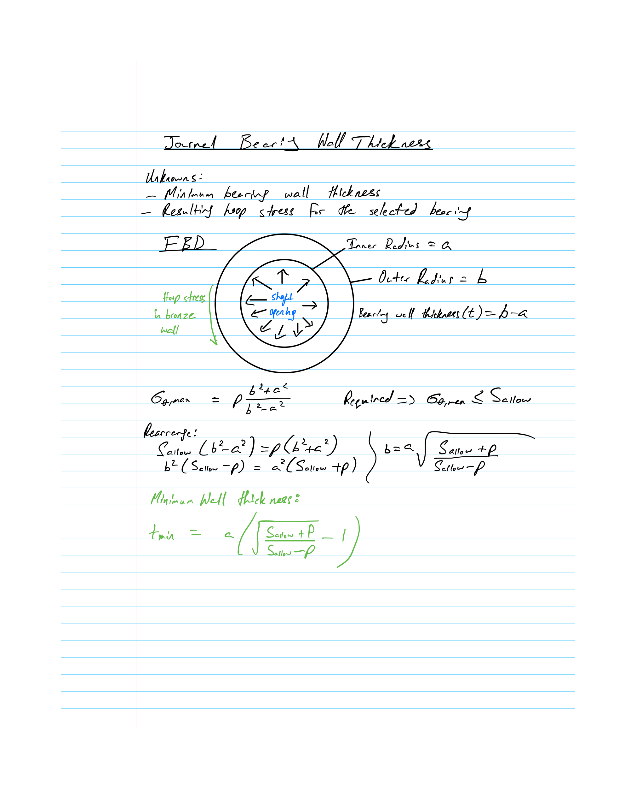
  <figcaption>Figure 6. Journal bearing wall-thickness analysis and hoop-stress model.</figcaption>
</figure>

<figure>
  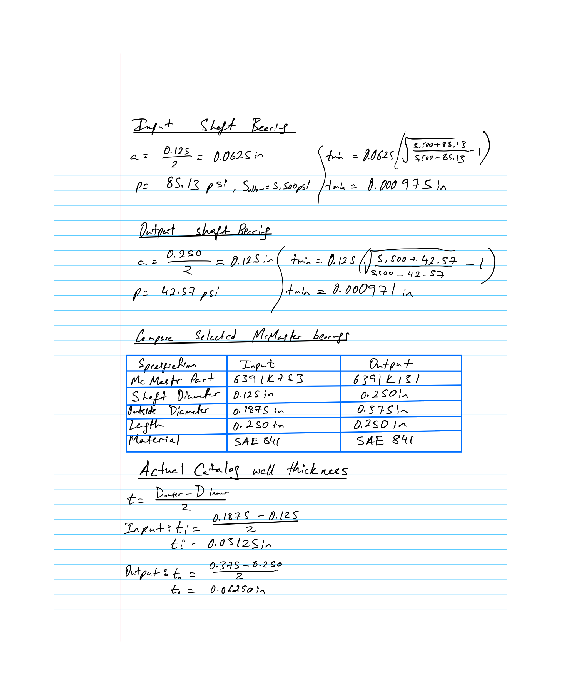
  <figcaption>Figure 7. Calculated minimum wall thicknesses and comparison with the selected sleeve bearings.</figcaption>
</figure>

The nominal dimensions of the selected bearings were:

| Specification | Input bearing | Output bearing |
| --- | --- | --- |
| McMaster-Carr part number | **6391K753** | **6391K131** |
| Inside diameter | 0.125 in | 0.250 in |
| Outside diameter | 0.1875 in | 0.375 in |
| Length | 0.250 in | 0.250 in |
| Calculated nominal wall thickness | 0.03125 in | 0.06250 in |

I used **two bearings for each shaft** in the CAD assembly: one supported by the main housing and one supported by the removable cover. The bearing outside diameters determined the housing and cover bearing-seat holes, while the shaft diameters matched the bearing inside diameters.

## Imagine

### Gear Layout and Housing Concept

I started the CAD design by establishing the relative positions of the gears. The pitch diameters were **0.375 in** for the input pinion and **1.000 in** for the output gear. This gave a required center-to-center shaft spacing of **0.6875 in**.

<figure>
  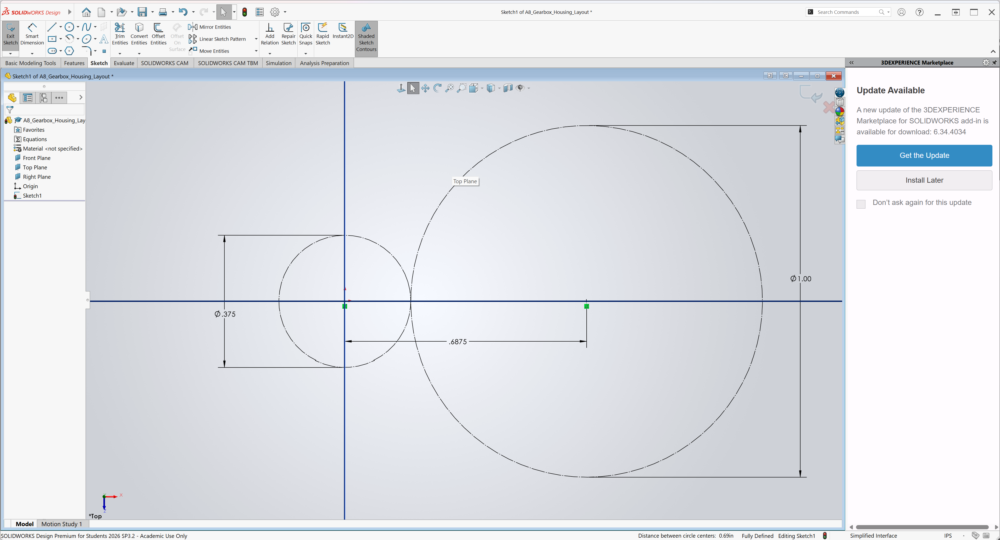
  <figcaption>Figure 8. Gear pitch-circle layout used to establish the shaft center distance.</figcaption>
</figure>

I chose a rectangular two-piece housing with the gears located inside a recessed cavity. The main housing supports the lower bearings, while the cover closes the enclosure and provides the upper bearing locations. This made the assembly relatively straightforward to model and allowed the cover to be removed to access the gears.

<figure>
  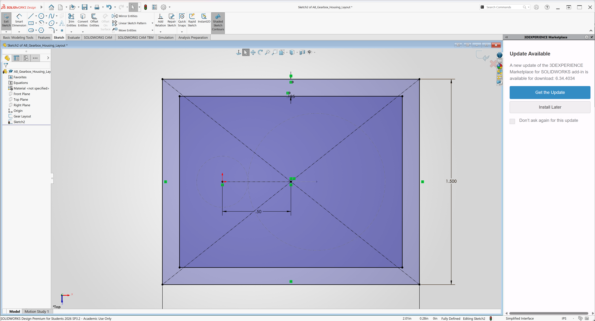
  <figcaption>Figure 9. Initial rectangular housing sketch with internal clearance and wall thickness.</figcaption>
</figure>

The main housing footprint was approximately **1.875 × 1.500 in**. I used nominal **0.125-inch walls** and a **0.500-inch internal wall height**, with a separate bottom plate and cover. The layout was sized around the gear geometry rather than just the shaft holes.

## Create

### Main Housing

I built the housing in SOLIDWORKS using the initial rectangular sketch as the reference for the walls. The walls were extruded first and then the bottom plate was added to create the gearbox cavity.

<figure>
  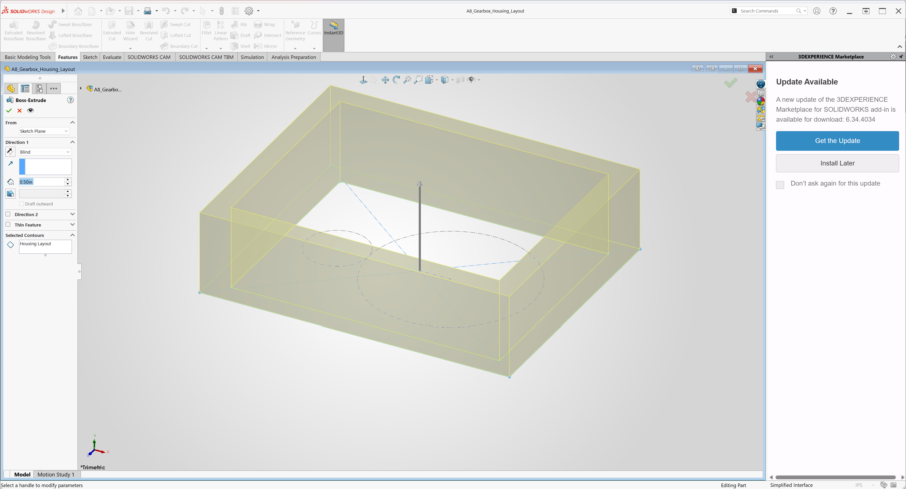
  <figcaption>Figure 10. Extruding the housing walls around the gear layout.</figcaption>
</figure>

<figure>
  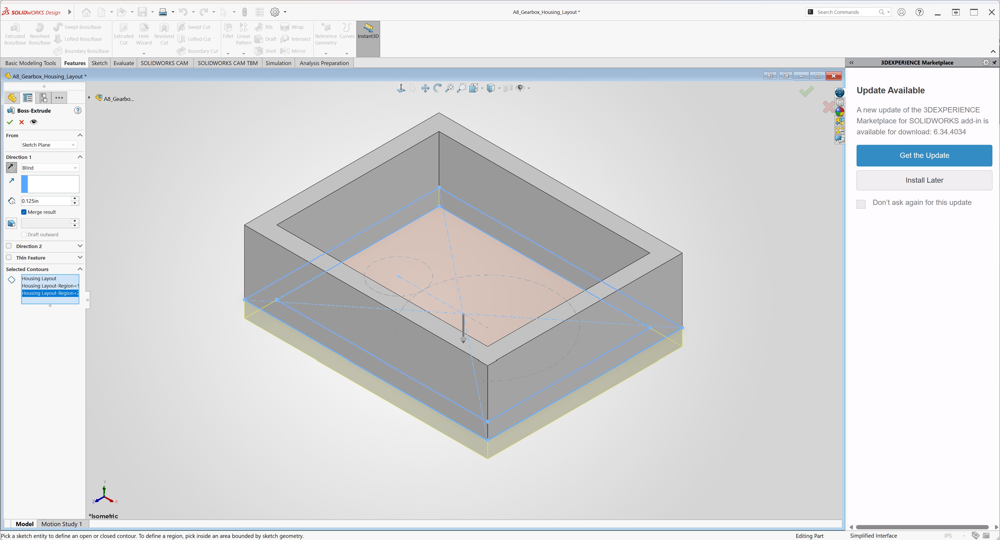
  <figcaption>Figure 11. Adding the bottom plate to the main gearbox housing.</figcaption>
</figure>

<figure>
  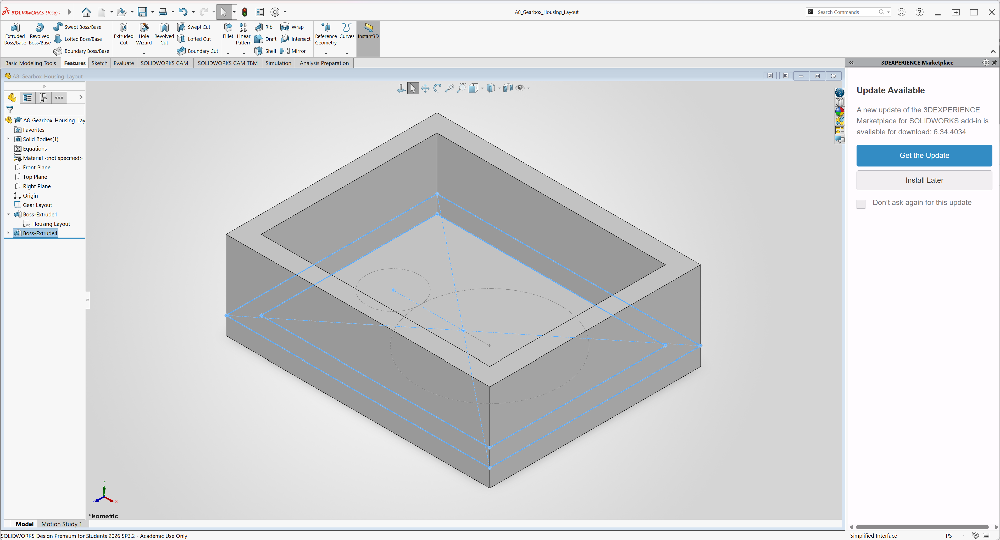
  <figcaption>Figure 12. Initial housing geometry before the bearing holes were added.</figcaption>
</figure>

### Bearing Seats and Shaft Openings

The next step was creating the housing features for the sleeve bearings. I used the **outside diameters of the bearings**, not the shaft diameters, for the corresponding bearing-seat holes. This distinction was important because the bearings remain stationary in the housing while the shafts rotate inside them.

<figure>
  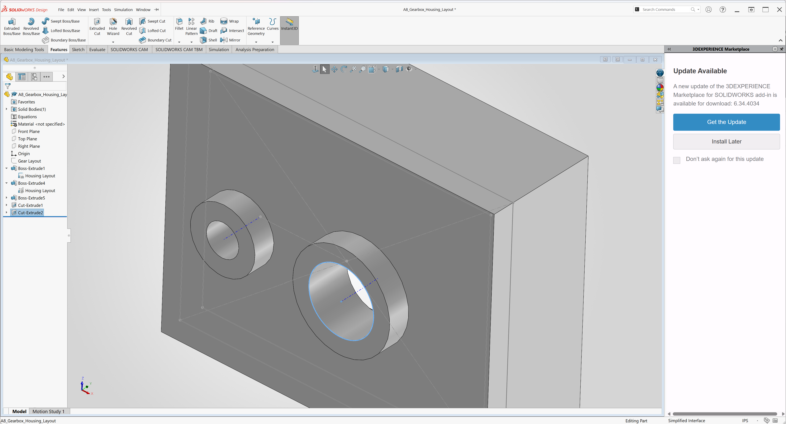
  <figcaption>Figure 13. Housing bearing locations for the input and output shafts.</figcaption>
</figure>

### Removable Cover

I modeled the cover as a separate part so the gearbox could be opened for assembly or maintenance. Its shaft and bearing holes were positioned using the same center spacing as the housing.

<figure>
  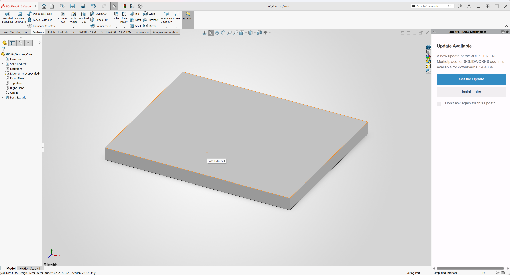
  <figcaption>Figure 14. Initial cover plate before adding the bearing features.</figcaption>
</figure>

<figure>
  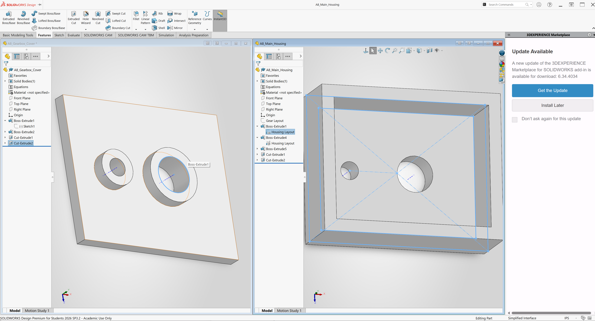
  <figcaption>Figure 15. Matching the cover bearing locations to the main housing.</figcaption>
</figure>

The main housing and cover were aligned in the assembly using coincident and concentric mates. I then inserted the sleeve bearings into the appropriate locations.

<figure>
  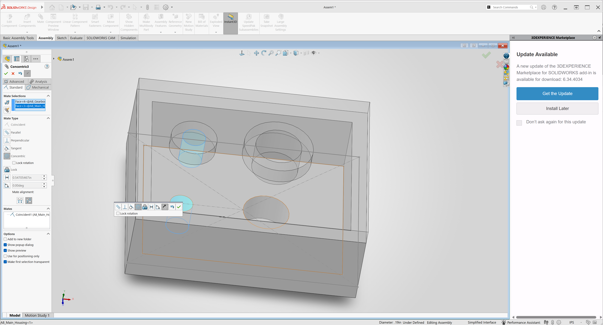
  <figcaption>Figure 16. Aligning the removable cover with the main housing.</figcaption>
</figure>

<figure>
  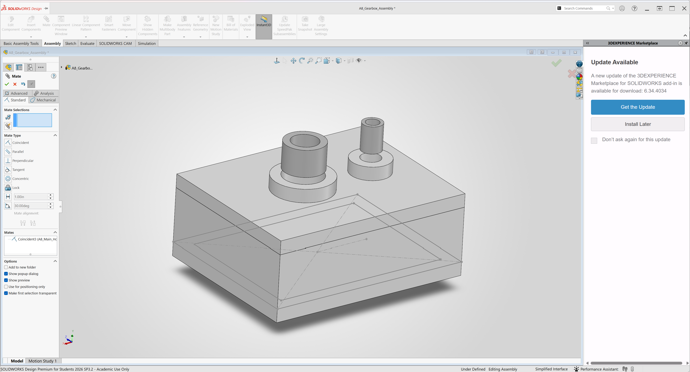
  <figcaption>Figure 17. Bearing and shaft locations established in the gearbox assembly.</figcaption>
</figure>

### Gears, Shafts and Assembly Mates

I downloaded the specified gears from McMaster-Carr and measured their geometry in SOLIDWORKS before finalizing their positions. Checking the pitch-circle layout and the overall gear dimensions helped me avoid using the wrong distance when assembling the teeth.

<figure>
  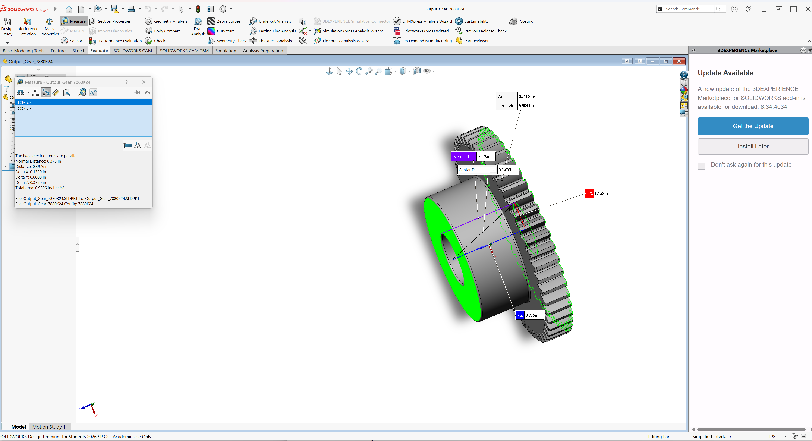
  <figcaption>Figure 18. Checking the downloaded gear geometry before assembly.</figcaption>
</figure>

I modeled the **1.000-inch-long input and output shafts** as separate cylindrical parts. Each shaft was positioned concentrically inside its sleeve bearings and each gear was mated concentrically to the correct shaft. The gear hubs were treated as **press-fit connections**, while the shafts were allowed to rotate inside the sleeve bearings.

<figure>
  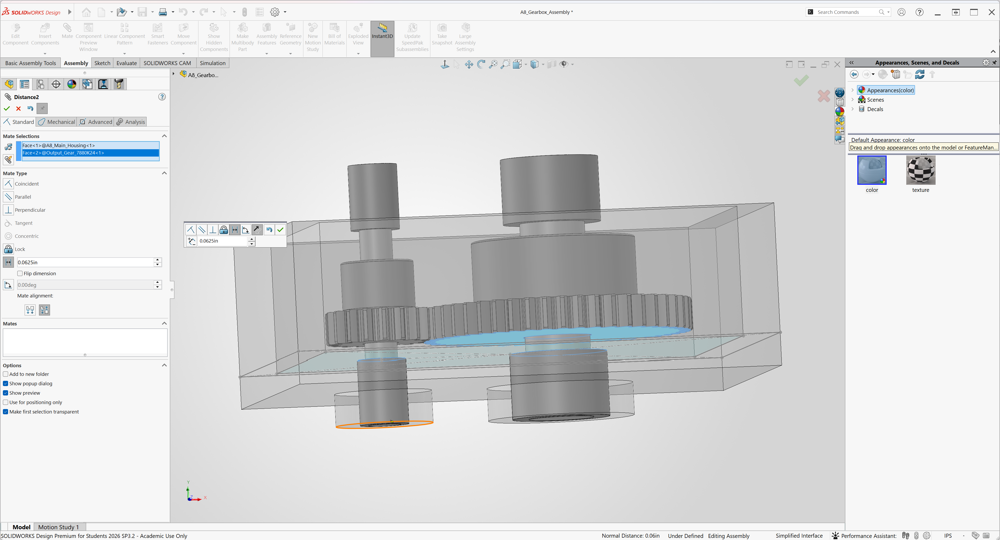
  <figcaption>Figure 19. Fitting the gears within the available housing space.</figcaption>
</figure>

I aligned the flat faces of the toothed portions so both gears occupied the same axial plane. I then adjusted the angular position of the teeth to reduce interference and added a Gear Mate to control their relative rotation.

<figure>
  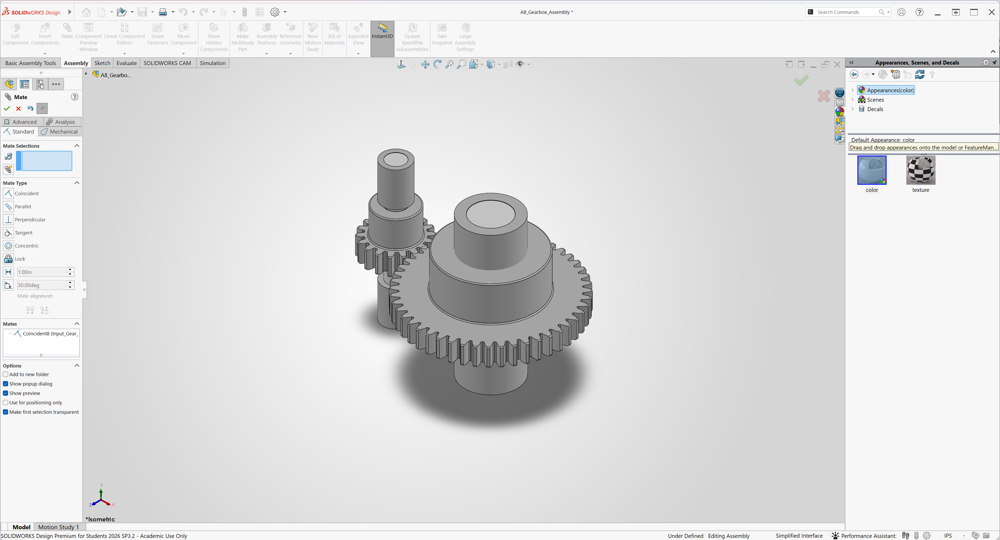
  <figcaption>Figure 20. Aligning the two gear faces before establishing the final gear relationship.</figcaption>
</figure>

The Gear Mate reproduced the expected opposite-direction rotation and the 18:48 gear ratio. I also locked the relative rotation of each gear to its own shaft to represent the press fit. I did **not** lock the shaft rotation relative to its bearings, because that would prevent the gearbox from operating.

<figure>
  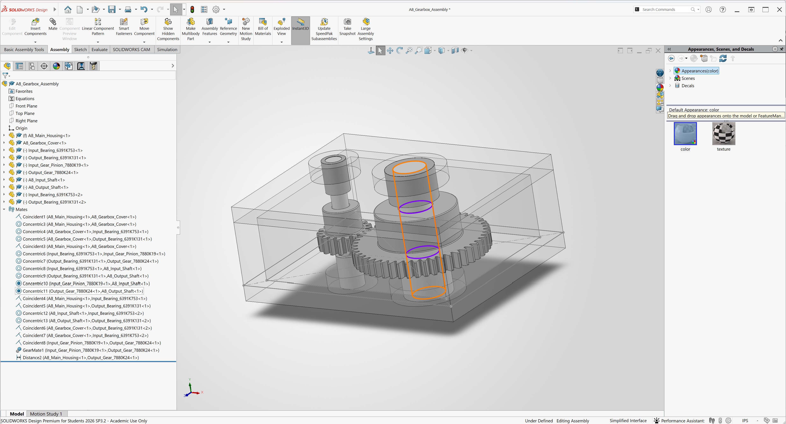
  <figcaption>Figure 21. Setting the mating relationships for the gear, shaft and bearing assembly.</figcaption>
</figure>

I added axial-position mates to stop the shafts from sliding while preserving their intended rotation. I then checked the gear and hub clearances inside the housing.

### Cover Fastening

To keep the housing removable without spending unnecessary time on a more complicated mounting design, I used **four socket-head cap screws**, one at each corner of the cover. I added matching fastener holes to the cover and housing and selected screws using the SOLIDWORKS Toolbox.

<figure>
  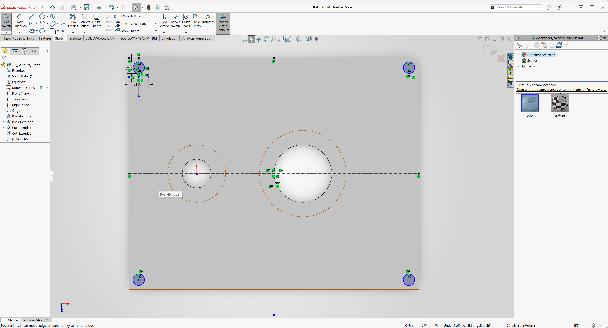
  <figcaption>Figure 22. Laying out the four cover fastener positions.</figcaption>
</figure>

<figure>
  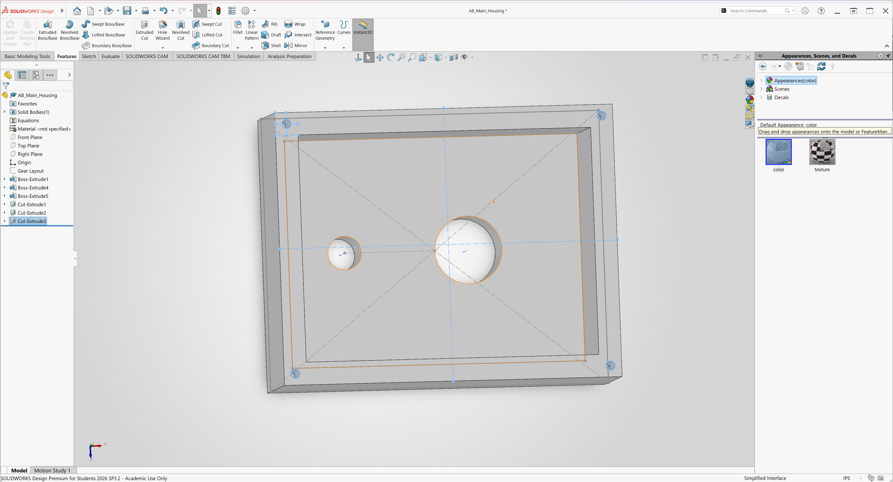
  <figcaption>Figure 23. Matching the corner fastener locations in the housing.</figcaption>
</figure>

<figure>
  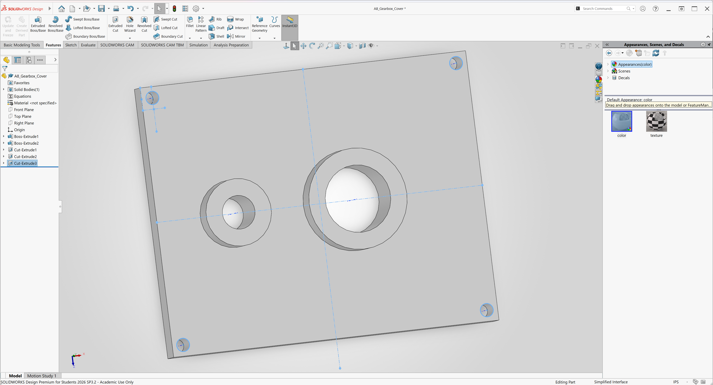
  <figcaption>Figure 24. Completed cover through-holes for the fasteners.</figcaption>
</figure>

<figure>
  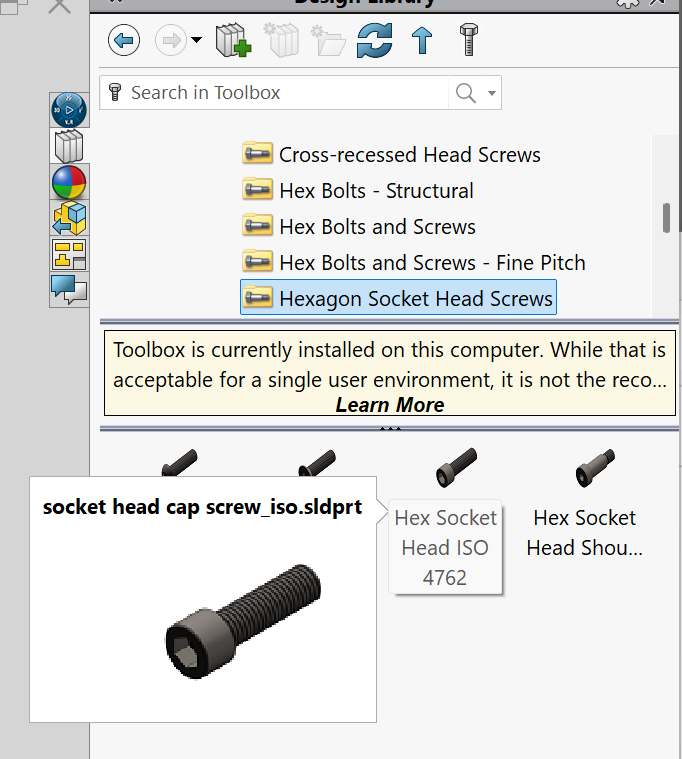
  <figcaption>Figure 25. Selecting socket-head cap screws from the SOLIDWORKS Toolbox.</figcaption>
</figure>

<figure>
  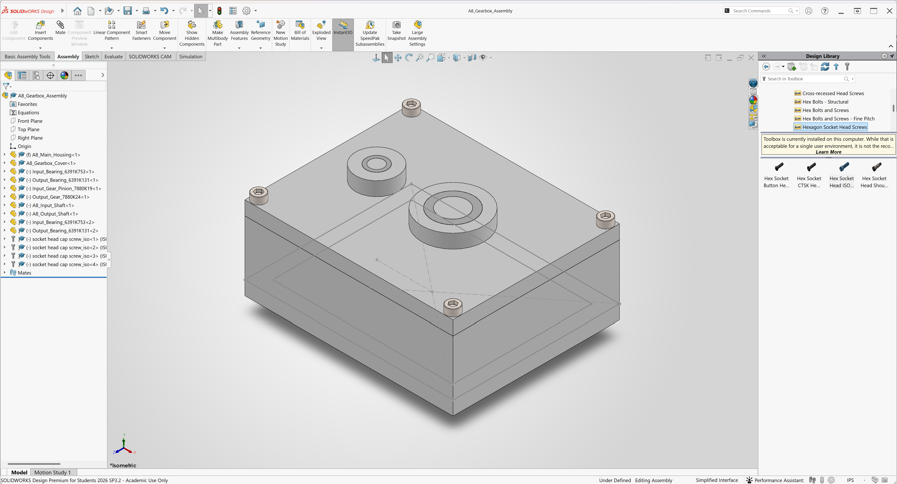
  <figcaption>Figure 26. Final gearbox with the cover fastened using four screws.</figcaption>
</figure>

The screws provide a simple way to remove the cover in the CAD design. Because the housing walls are relatively thin, the fastener dimensions and threaded engagement would need additional verification before fabrication.

### Final Assembly and Interference Check

After assembling the shafts, bearings, gears, cover and fasteners, I tested the mechanism using SOLIDWORKS assembly motion. The gears rotated in opposite directions at the intended ratio and the shafts remained axially located while still rotating in their bearings.

I also used **Interference Detection** during the gear alignment process. Small tooth interference was observed during the initial manual positioning, so I adjusted the gear orientation and rechecked it. After completing the assembly, the final interference check reported **no interference** in the checked position.

<figure>
  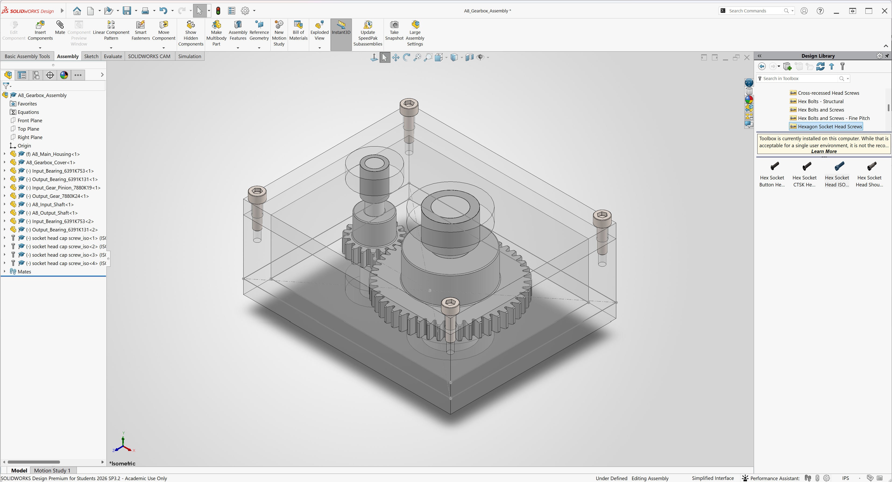
  <figcaption>Figure 27. Transparent view of the complete gearbox assembly and its internal components.</figcaption>
</figure>

The final interference check supports the absence of modeled collisions in the checked assembly position. It does not replace manufacturing-fit verification or guarantee collision-free motion through every gear angle.

## Decide

### Final Component Choices

| Component | Selected design or part |
| --- | --- |
| Input pinion | McMaster-Carr **7880K19**, 18 teeth |
| Output gear | McMaster-Carr **7880K24**, 48 teeth |
| Input shaft | Modeled 0.125 in diameter × 1.000 in long |
| Output shaft | Modeled 0.250 in diameter × 1.000 in long |
| Input sleeve bearing | McMaster-Carr **6391K753**, two used |
| Output sleeve bearing | McMaster-Carr **6391K131**, two used |
| Housing | Two-part rectangular main housing and removable cover |
| Fasteners | Four ISO 4762 socket-head cap screws, M1.6 × 6 mm, as modeled |

### Design Decisions and Tradeoffs

I kept the shaft diameters specified in the assignment because the torsional-stress calculations indicated that they were sufficient under my stated assumptions. I used two sleeve bearings per shaft so each shaft could be supported by the housing and the cover. I also chose a rectangular housing because it was simple to sketch, dimension and manufacture conceptually.

The screw-fastened cover was a practical compromise: it satisfied the goal of a removable enclosure without adding more complicated snap-fit geometry or mounting bosses. This CAD model demonstrates the arrangement but the bearing fits, press-fit tolerances, screw engagement and materials would need further review before physical production.

## Communicate

### MEGR 2157 - Engineering Drawings

I created a multi-sheet SOLIDWORKS drawing file using third-angle orthographic views and isometric views to show the gearbox geometry and component relationships. The drawings include dimensions for the housing, cover and shafts. The screenshots below show the drawing sheets captured during this assignment.

<figure>
  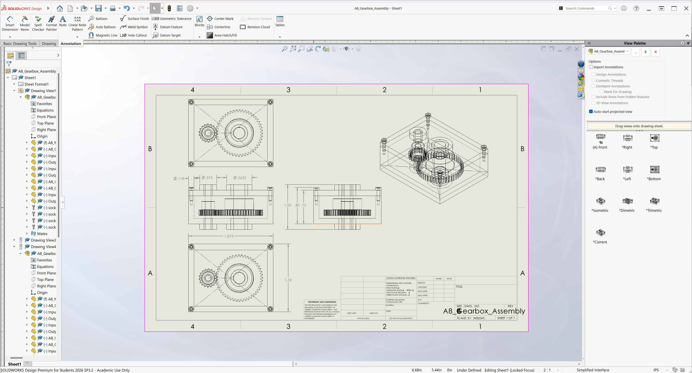
  <figcaption>Figure 28. Gearbox assembly drawing.</figcaption>
</figure>

<figure>
  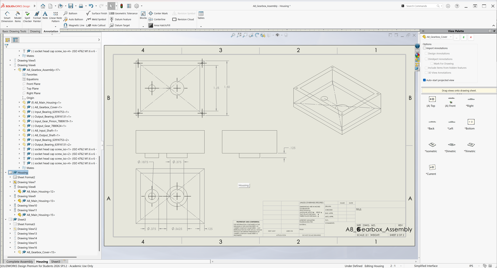
  <figcaption>Figure 29. Main housing drawing.</figcaption>
</figure>

<figure>
  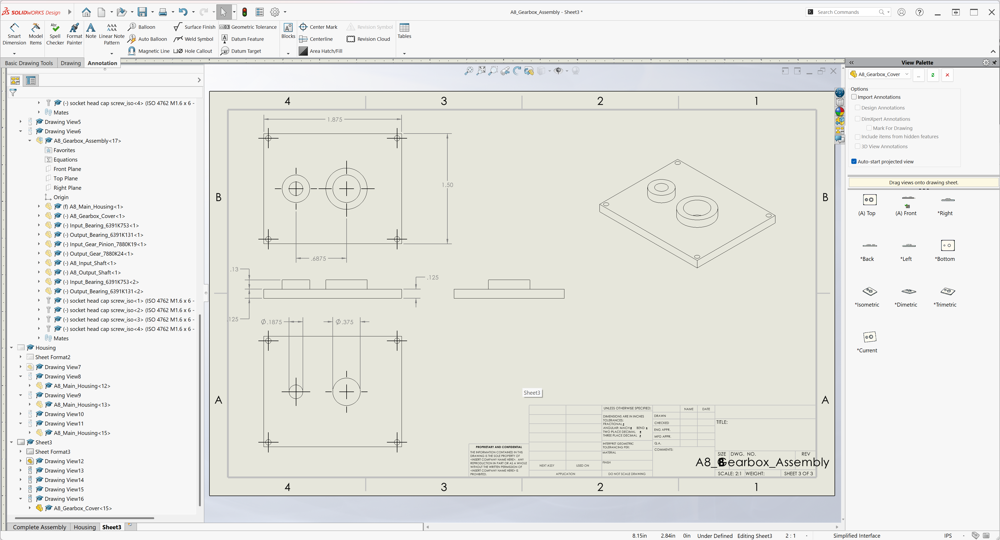
  <figcaption>Figure 30. Cover drawing.</figcaption>
</figure>

<figure>
  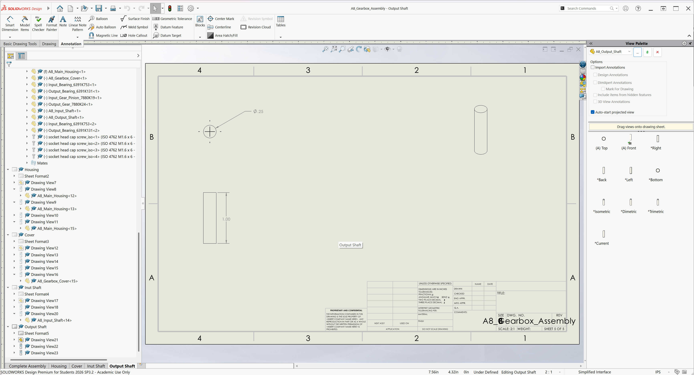
  <figcaption>Figure 31. Output shaft drawing.</figcaption>
</figure>

<!-- Before publishing a fifth drawing figure: replace images/Input_Shaft_drawing.png with an actual screenshot of the INPUT SHAFT drawing. The currently supplied image shows the cover sheet while the shaft view palette is open. -->

The full MEGR 2157 drawing requirements also include separate drawings for the **input shaft** and **both sleeve bearings**. These should be completed or verified in the native drawing file before final submission, along with the required drawing tolerances and critical-feature callouts.

### Lessons Learned

This assignment helped me understand how the various parts of a gearbox work together. At first, I confused the **outside diameter of a sleeve bearing** with the **diameter of the shaft** that passes through it. I learned that the bearing is seated in the housing, the shaft rotates inside the bearing and the gear hub is press-fitted to the shaft. That distinction determined which holes needed to be made in the housing and cover.

I also learned that **pitch diameters**, rather than outside diameters, establish the correct center distance for meshing gears. Even after placing the gears at the correct center distance, I still needed to align their faces and initial tooth positions. The SOLIDWORKS Gear Mate controlled the rotational relationship but it did not automatically prevent physical tooth interference. Using Interference Detection showed why checking the actual geometry is necessary.

Another lesson was the difference between **assembly motion** and **assembly constraint**. The shafts needed to rotate but they were not supposed to slide axially. Concentric mates alone did not prevent that sliding, so I used additional mates to position the shafts while retaining the rotational freedom necessary for the gearbox to operate.

Finally, I learned how using separate SOLIDWORKS parts, a complete assembly, Toolbox fasteners and multiple drawing sheets makes it easier to manage and document a mechanical design. The final gearbox is a functional CAD concept, while manufacturing tolerances and fastening details remain areas for more detailed design work.

### Time Spent

**Actual time spent:** 14 hours

### CAD Files

- [Download complete gearbox CAD assembly](files/A8_Gearbox_Assembly.zip)
- [Download SOLIDWORKS multi-sheet drawing](files/A8_Gearbox_Assembly.SLDDRW)

The downloadable ZIP contains the CAD package for the gearbox assembly. The drawing files has multiple sheets showing the different components.
