# A9 - Pulley System Design

## Objective

The objective of this assignment was to design a belt-driven pulley system that transfers power between two parallel shafts. The design required me to analyze belt tension and friction, size the shafts for transmitted torque, select journal bearings and create a supporting frame. I then modeled and assembled the system in SOLIDWORKS using custom parts and commercially available components.

The completed CAD concept uses **two equal-diameter grooved pulleys**, a **round polyurethane belt**, **two steel shafts**, **four oil-impregnated bronze sleeve bearings** and an **aluminum support frame with a center spacer**.

### Design Requirements and Selected Parameters

| Parameter | Requirement or selected value |
| --- | --- |
| Pulley diameter | 3.000 in, both pulleys |
| Shaft center distance | 5.000 in (within the required 4–6 in) |
| Operating speed | 1,500 rpm (within the required 1,000–2,000 rpm) |
| Initial static belt tension | 5.0 lbf (within the required 4–6 lbf) |
| Pulley material | Aluminum |
| Belt material | Polyurethane rubber |
| Polyurethane yield strength used | 471 psi |
| Minimum safety factor | 3 |
| Selected shaft diameter | 0.1875 in |
| Shaft material | AISI 1060 hardened steel |
| Selected sleeve bearing | McMaster-Carr 6391K114, four total |
| Selected round belt | McMaster-Carr 3044K606 |

## Analyze

### Belt Forces, Friction and Power Transmission

I started by identifying the design parameters and drawing a free-body diagram of the two-pulley system. Since both pulleys have the same diameter, they are intended to operate at a **1:1 speed ratio**. I selected a 5-inch shaft center distance and a 1,500-rpm operating speed.

<figure>
  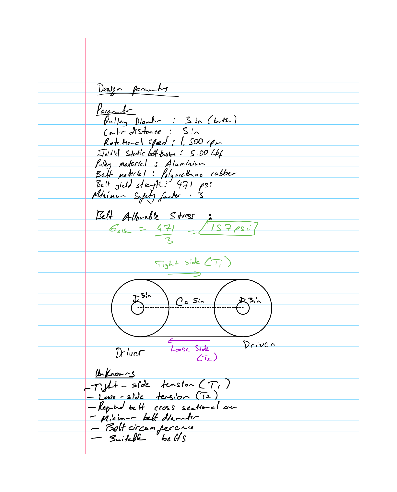
  <figcaption>Figure 1. Design requirements, selected operating conditions and the initial pulley-system free-body diagram.</figcaption>
</figure>

For the belt-force analysis, I assumed a **0.30 coefficient of friction** and a **180-degree wrap angle**. I calculated the tight-side and loose-side forces and checked their ratio against the no-slip condition. Under those assumptions, the estimated tensions were **7 lbf** on the tight side and **3 lbf** on the loose side. The corresponding transmitted torque was **6 in-lbf**.

<figure>
  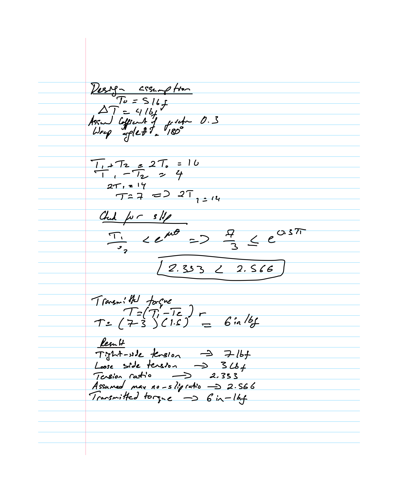
  <figcaption>Figure 2. Tight-side and loose-side tensions, assumed friction limit, no-slip check and transmitted torque.</figcaption>
</figure>

The calculated tension ratio was approximately **2.333**, below the assumed maximum no-slip ratio of approximately **2.566**. This is a theoretical check based on the selected friction coefficient, not an experimental confirmation of belt traction.

### Belt Diameter and Catalog Selection

I used the polyurethane yield strength and required safety factor to estimate the minimum belt cross-sectional area and diameter. The minimum calculated diameter was approximately **0.238 in**, so I selected a standard **0.250-inch-diameter round belt**. The resulting calculated tensile stress was approximately **142.6 psi**, corresponding to a stress-based safety-factor ratio of approximately **3.30** under the assumed maximum belt tension.

I also calculated the belt length from the two equal pulleys and their 5-inch center distance. The estimated belt centerline length was **19.425 in**, with an estimated outside circumference of approximately **20.21 in** for the selected round cross-section.

<figure>
  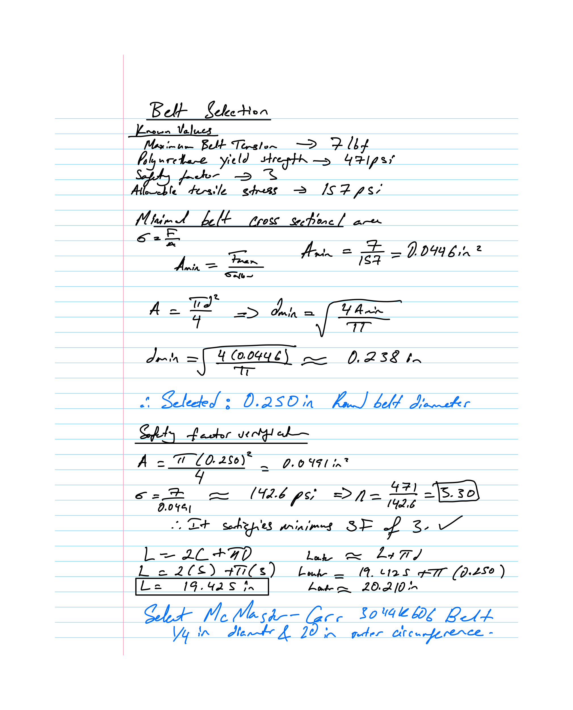
  <figcaption>Figure 3. Belt diameter selection, tensile-stress check, estimated circumference and catalog selection.</figcaption>
</figure>

I selected **McMaster-Carr 3044K606**, a polyurethane round belt with a nominal **0.250-inch diameter** and **20-inch outer circumference**. Its catalog circumference is close to the estimated installed outer circumference; however, this comparison alone does not establish the actual installed pretension.

<figure>
  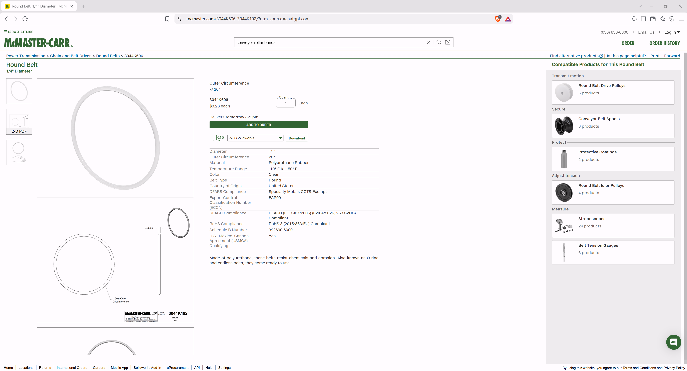
  <figcaption>Figure 4. Selected McMaster-Carr polyurethane round belt, part 3044K606.</figcaption>
</figure>

### Shaft Design

Next, I calculated the minimum shaft diameter needed to carry the estimated **6 in-lbf torque** using the stated properties of AISI 1060 hardened steel and the required safety factor. My handwritten work includes the shaft free-body diagram, allowable torsional shear stress, minimum diameter and the check of the final size.

<figure>
  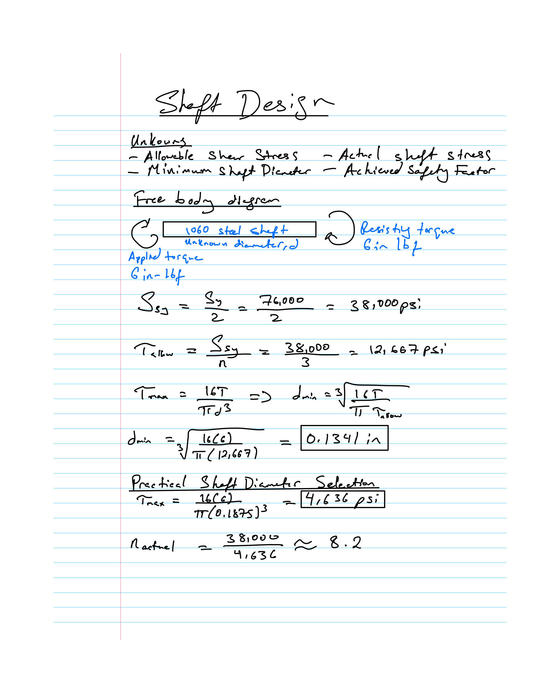
  <figcaption>Figure 5. Shaft design and torsional-stress adequacy calculation.</figcaption>
</figure>

The calculated minimum shaft diameter was approximately **0.1341 in**. I selected a more practical **0.1875-inch shaft diameter** for both shafts. The estimated torsional shear stress for the selected diameter was approximately **4,636 psi**, with a stress-based safety-factor ratio of approximately **8.2** under the assumed torque loading. This check considers torsion; it does not represent a full combined bending-and-fatigue analysis.

### Journal Bearing Design

Each shaft is supported by two sleeve bearings, one in the upper support plate and one in the lower support plate. I used a simplified symmetrical loading model in which the combined belt load was **10 lbf**, shared equally between two bearings on a shaft, giving **5 lbf per bearing**.

<figure>
  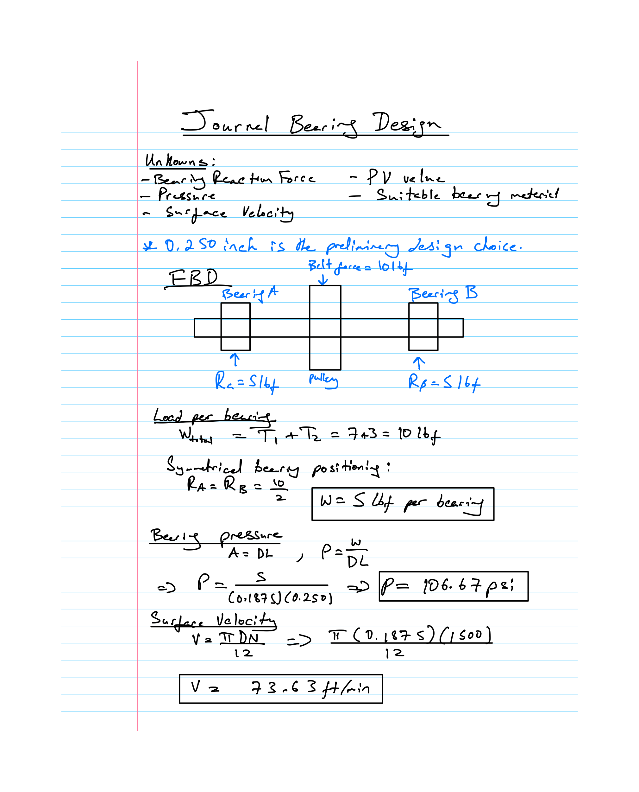
  <figcaption>Figure 6. Bearing loading model, reaction forces, projected pressure and sliding velocity.</figcaption>
</figure>

Using the selected **0.1875-inch shaft diameter**, a **0.250-inch bearing length** and **1,500 rpm**, I obtained an estimated bearing pressure of **106.67 psi** and a surface velocity of **73.63 ft/min**. The calculated PV value was approximately **7,854 psi-ft/min**.

<figure>
  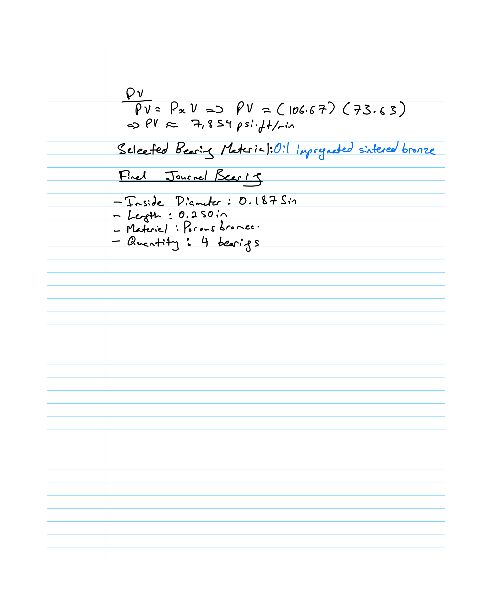
  <figcaption>Figure 7. Calculated bearing PV value and final journal bearing material choice.</figcaption>
</figure>

I selected **SAE 841 oil-impregnated sintered bronze** sleeve bearings, McMaster-Carr **6391K114**, for the bearing arrangement. The catalog lists a nominal **0.1875-inch inside diameter**, approximately **0.3135-inch outside diameter** and **0.250-inch length**. I used **four bearings** in total, providing two support locations for each shaft.

<figure>
  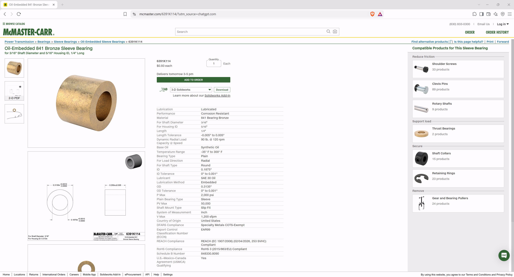
  <figcaption>Figure 8. Selected sleeve bearing, McMaster-Carr 6391K114.</figcaption>
</figure>

The calculated PV value was below the **50,000 psi-ft/min catalog maximum** shown for this bearing. Actual performance would still depend on the finished fits, operating temperature, shaft condition, lubrication and loading.

## Imagine

### Pulley and Frame Concept

I chose an **open-belt arrangement** with two identical pulleys, which transfers rotation between parallel shafts without a speed reduction. A circular cross-section was appropriate for the selected round belt, so each pulley needed a matching rounded circumferential groove.

For the supporting structure, I chose two parallel aluminum plates with aligned shaft openings. This arrangement allows the pulleys to sit between the supports while leaving the shafts accessible. I also considered how to maintain the spacing between the plates and keep them aligned.

<figure>
  
  <figcaption>Figure 9. Initial support frame with two bearing locations and rounded ends.</figcaption>
</figure>

I decided to use a **central rectangular spacer** between the plates. During modeling, I refined that idea by adding a shallow pocket to the support plate so the spacer would have a more definite location rather than relying only on two flat contact surfaces.

## Plan

### Component Arrangement and Materials

I organized the system into separately modeled parts: one pulley model used twice, one support plate model used twice, two shafts, four identical sleeve bearings, one center spacer and a belt part generated from the installed path.

| Component | Quantity | Material or source | Design purpose |
| --- | ---: | --- | --- |
| Grooved pulley | 2 | Aluminum | Transfers motion through the round belt |
| Shaft | 2 | AISI 1060 hardened steel | Carries pulley torque |
| Sleeve bearing | 4 | McMaster-Carr 6391K114; SAE 841 bronze | Supports shaft rotation |
| Support frame plate | 2 | Aluminum 6061-T6 | Holds the two shaft axes parallel |
| Central spacer | 1 | Modeled structural spacer | Maintains separation and alignment of the frame plates |
| Round belt | 1 | McMaster-Carr 3044K606; polyurethane | Connects the pulley rotation |

I planned to make the **pulley groove centered through the thickness**, to maintain a **5-inch spacing between the shaft axes** and to position the upper and lower support plates with assembly mates. The spacer and its recessed seat would control the separation between the two plates.

The belt would be modeled **after the pulleys were positioned** so its path could follow the actual groove centers in the assembly.

## Create

### Modeling the Pulleys

I first created the main pulley blank with a central shaft opening. The blank was modeled as an extruded circular part before the round-belt groove was added.

<figure>
  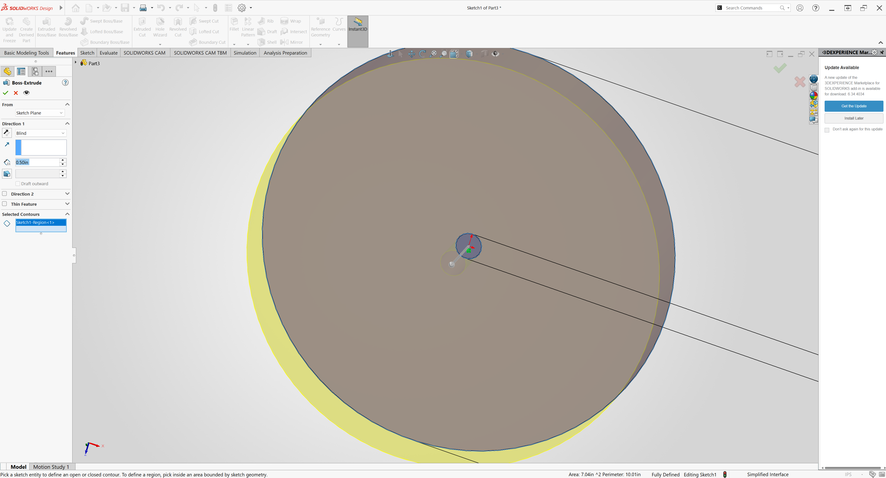
  <figcaption>Figure 10. Creating the initial pulley blank using Boss-Extrude.</figcaption>
</figure>

I then sketched the groove profile on a plane through the pulley axis. The groove was positioned at the mid-thickness of the pulley and shaped for the **0.250-inch round belt**.

<figure>
  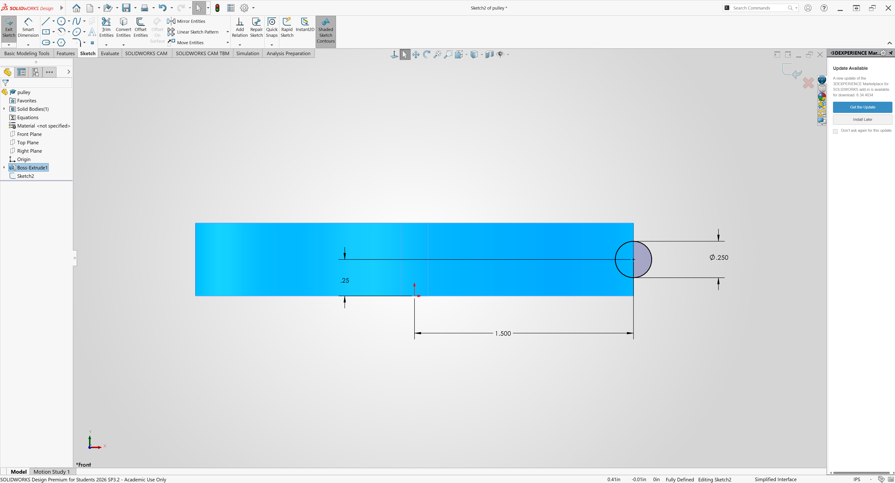
  <figcaption>Figure 11. Sketching the circular groove profile for the round belt.</figcaption>
</figure>

Using **Cut-Revolve**, I revolved the profile through 360 degrees to remove material around the pulley circumference.

<figure>
  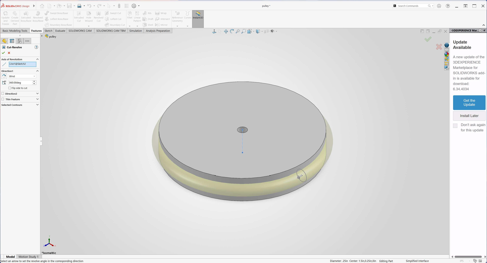
  <figcaption>Figure 12. Creating the continuous pulley groove using Cut-Revolve.</figcaption>
</figure>

<figure>
  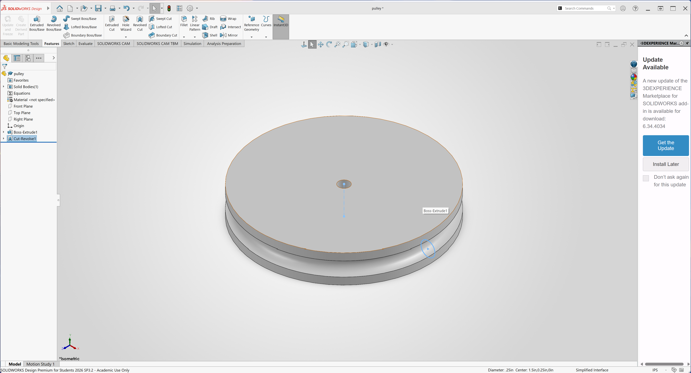
  <figcaption>Figure 13. Completed pulley with a centered circumferential round-belt groove.</figcaption>
</figure>

### Support Plates and Spacer Improvement

I modeled a long support plate with rounded ends and openings for the sleeve bearings. Two instances of this part form the upper and lower supports. I created a central rectangular spacer to maintain the distance between the plates.

<figure>
  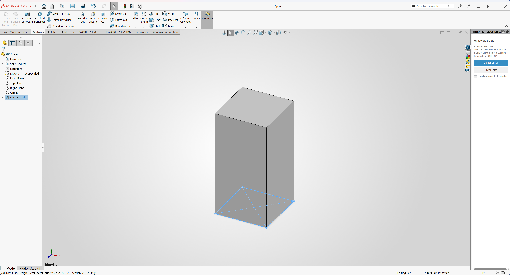
  <figcaption>Figure 14. Modeling the center spacer as a separate part.</figcaption>
</figure>

Initially, the spacer would have rested on the flat plate surface. I revised the design by adding a **shallow rectangular recess** in the frame, approximately **0.050 in deep**, to give the spacer a defined seating location. This was a simple improvement that made positioning the frame components easier in the assembly.

<figure>
  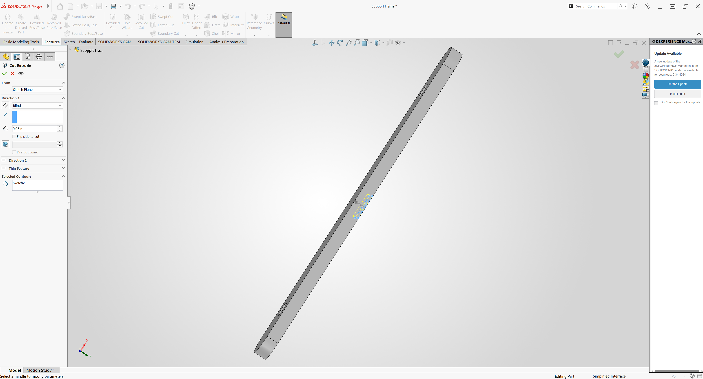
  <figcaption>Figure 15. Adding a shallow pocket to locate the center spacer.</figcaption>
</figure>

<figure>
  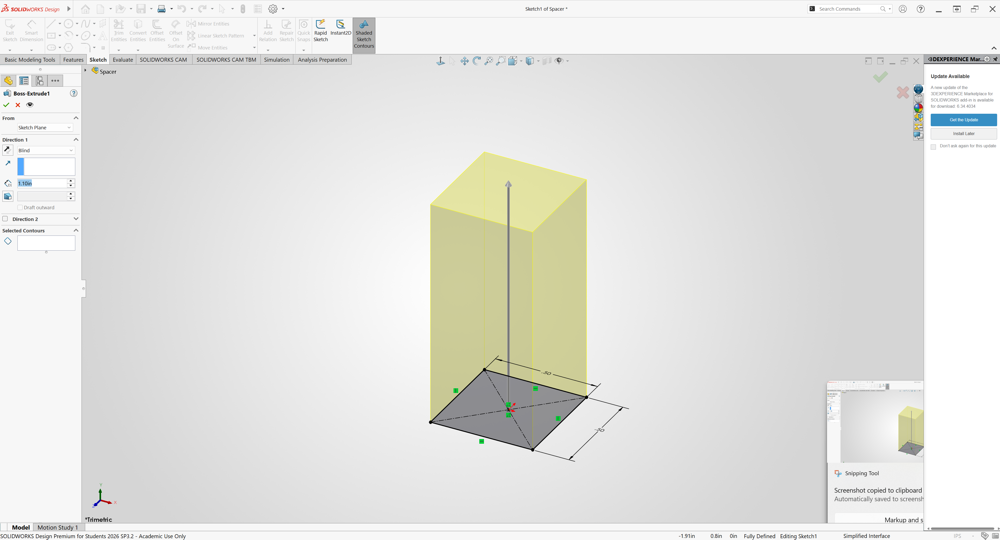
  <figcaption>Figure 16. Updated frame and spacer geometry.</figcaption>
</figure>

<figure>
  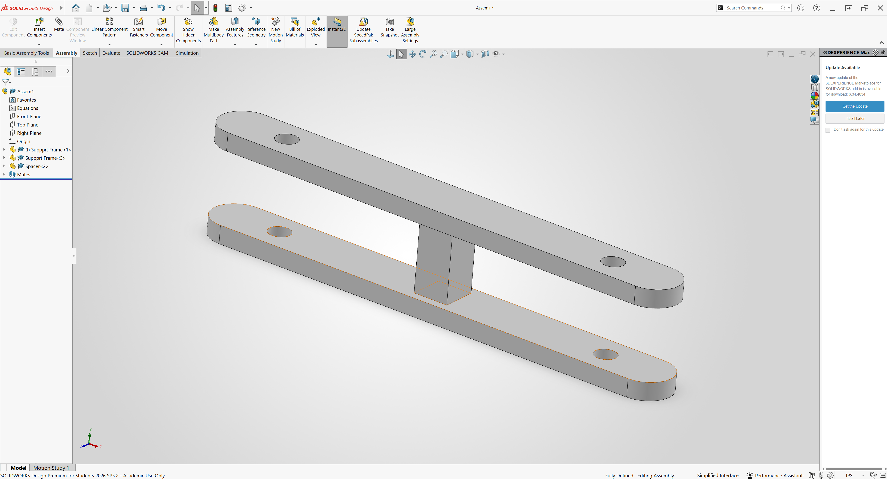
  <figcaption>Figure 17. Spacer seated between the support plates.</figcaption>
</figure>

### Assembling the Shaft Supports and Pulleys

I created a SOLIDWORKS assembly and inserted the two support plates, spacer, shafts, sleeve bearings and pulleys. I used **concentric mates** to align shafts, bearings and pulley bores, then **coincident and distance mates** to establish their axial positions and the spacing between the plates.

<figure>
  
  <figcaption>Figure 18. Aligning the upper and lower support plates around the center spacer.</figcaption>
</figure>

<figure>
  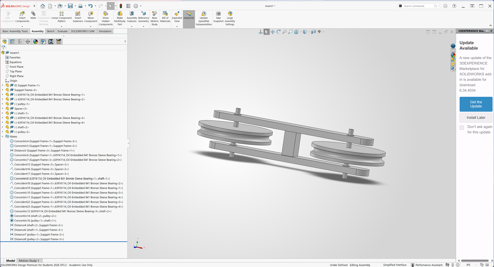
  <figcaption>Figure 19. Installing the pulleys, shafts and sleeve bearings into the supporting frame.</figcaption>
</figure>

The shaft axes were spaced **5.000 in** apart and the pulley faces were aligned so the belt could run through the center of both grooves. I kept the pulleys free to rotate while controlling their axial locations.

### Creating and Positioning the Round Belt

I initially encountered a modeling limitation: **SOLIDWORKS Belt/Chain would not accept the curved, revolved groove surface as a cylindrical belt member**. Instead of redesigning the groove, I selected circular reference edges for the two pulleys, set the effective pulley diameters and established a reference plane through the **groove centers**.

<figure>
  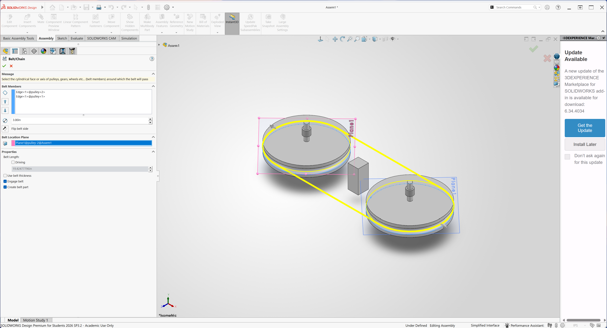
  <figcaption>Figure 20. Defining the Belt/Chain path and locating it at the center of the pulley grooves.</figcaption>
</figure>

I enabled **Engage Belt** to create the intended rotational relationship and **Create Belt Part** to generate the installed belt path. I then used **Swept Boss/Base** with a **0.250-inch circular profile** to produce a visible round belt. I assigned the belt polyurethane material.

<figure>
  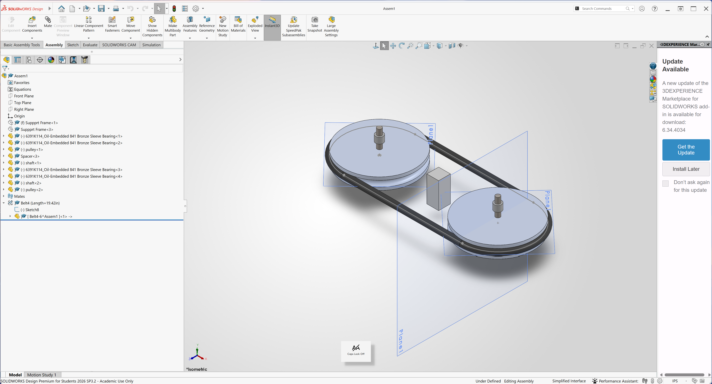
  <figcaption>Figure 21. The completed swept round-belt model.</figcaption>
</figure>

The manufacturer-supplied belt model represents the undeformed circular belt. My swept part instead represents its **installed path around two separated pulleys**. It is a geometric assembly model and does not simulate the belt's actual elastic stretch or installed pretension.

### Completed Pulley Assembly

After inserting the belt, I displayed the support plates and inspected the final arrangement. The belt follows both pulley grooves, the shaft positions are aligned and the central spacer sits between the two plates without crossing the visible belt path.

<figure>
  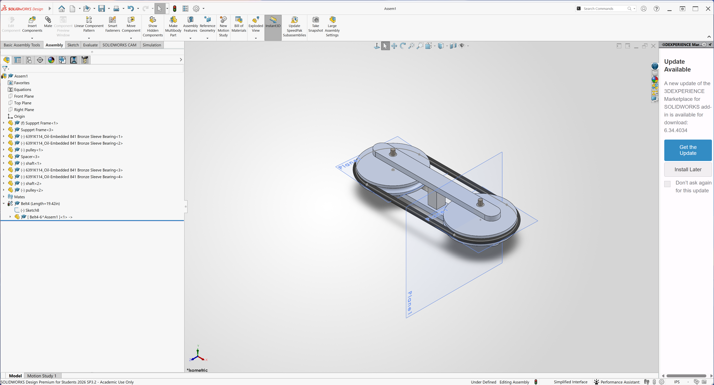
  <figcaption>Figure 22. Completed belt-driven pulley assembly.</figcaption>
</figure>

<figure>
  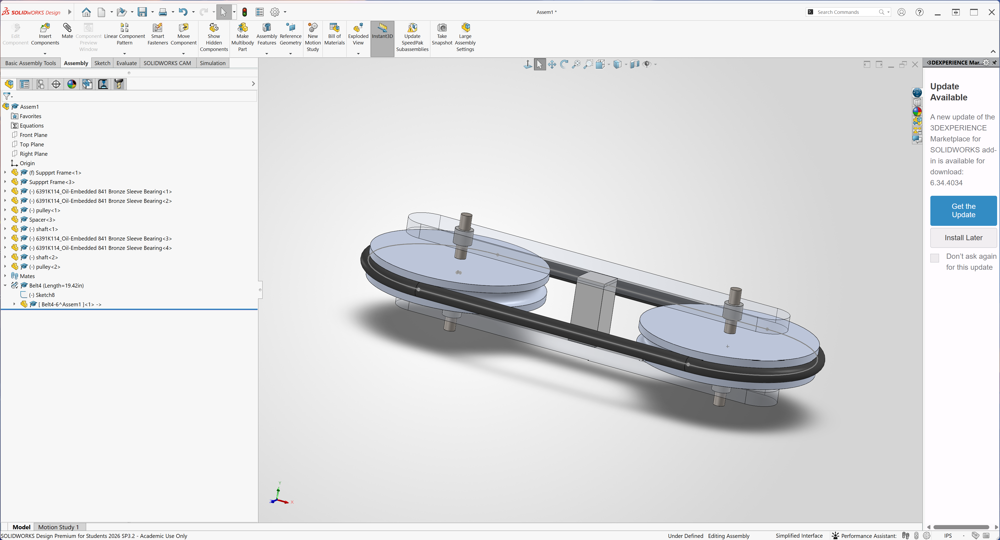
  <figcaption>Figure 23. Assembly view showing the relationship between the pulleys, shafts, bearings and supports.</figcaption>
</figure>

## Decide

### Final Design Decisions

I retained the **3-inch aluminum pulleys**, **5-inch shaft spacing** and **1,500-rpm operating speed** because these values meet the dimensional and speed requirements of the assignment. I selected the **0.250-inch round polyurethane belt** because my estimated tensile-stress safety factor exceeded the required minimum of three.

I selected **0.1875-inch-diameter steel shafts** instead of using the smaller calculated minimum diameter. The larger standard size provided more margin under the torsional loading assumptions and matched a commercially available SAE 841 bronze sleeve bearing.

I also retained the **two-plate frame with a center spacer**, but revised the support plate to incorporate the locating pocket. This reduced ambiguity in the spacer's placement and gave the support structure a clearer assembly interface.

### Design Checks and Limitations

| Check | Result or observation |
| --- | --- |
| Geometric constraints | Two 3-inch pulleys with 5-inch shaft spacing |
| Speed ratio | Nominal 1:1, because the pulley diameters are equal |
| Belt friction check | No-slip criterion satisfied under the assumed friction coefficient |
| Belt stress check | Calculated safety-factor ratio approximately 3.30 |
| Shaft torsional check | Calculated safety-factor ratio approximately 8.2 |
| Bearing PV estimate | Approximately 7,854 psi-ft/min, below the selected catalog PV maximum |
| CAD belt placement | Round belt visually aligned with both pulley grooves |
| Frame modification | Recessed locating seat added for the spacer |

These results describe the **analytical design and CAD arrangement**. The model does not by itself validate the real belt pretension, manufacturing fits, pulley-to-shaft torque transmission method, bearing life or dynamic vibration. A physical prototype would require additional verification.

## Communicate

### Final Presentation

The final assembly contains the two grooved pulleys, the installed round belt, four sleeve bearings, the shafts, two aluminum support plates and the fitted center spacer. I organized the parts as a SOLIDWORKS assembly so the component relationships and belt path can be inspected together.

<figure>
  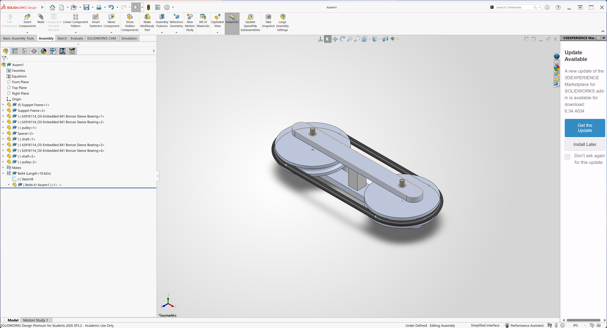
  <figcaption>Figure 24. Final isometric view of the completed A9 pulley system.</figcaption>
</figure>

### Engineering Lessons Learned

The most important lesson was that **sizing a belt and modeling its installed geometry are different tasks**. The analytical calculation provided a minimum belt diameter and estimated length, while SOLIDWORKS required a separate belt path through the pulley grooves. I learned that a rounded groove created by Cut-Revolve is not the same as the cylindrical surface expected by the Belt/Chain feature. Using circular reference geometry and a groove-center plane allowed me to produce the intended path without changing the pulley design.

I also learned how **belt friction limits the usable difference between tight-side and loose-side tension**. Simply increasing tension does not automatically establish a slip-free design; the friction coefficient and wrap angle limit the allowable tension ratio. My calculated no-slip result therefore depends on those stated assumptions.

The bearing analysis helped me connect **applied shaft load, bearing pressure, surface velocity and PV rating** to a real catalog selection. I used the bearing's inside diameter to match the shaft and its outside diameter to establish the support-plate opening. This clarified how a sleeve bearing lets a rotating shaft be supported by a stationary frame.

Finally, I learned that **assembly details can improve a design without making it more complicated**. Adding the shallow spacer pocket provided a repeatable locating feature for the frame. That small revision improved the clarity of the assembly and reduced my reliance on manually positioning the spacer between two flat surfaces.

### Mistakes and Revisions

The two main revisions during this project were the **spacer location** and the **belt modeling method**. I first used a flat contact surface for the spacer, then added a recess to locate it more positively. I also initially tried to select the curved pulley groove in the Belt/Chain command before learning to define the belt path using circular geometry and a center plane. Both adjustments let me keep the overall design while improving the assembly workflow.

### Time Spent

**Actual time spent:** 5 hours

### CAD Files

[Download complete A9 SOLIDWORKS pulley assembly](files/A09_Pulley_Assembly.zip)

The ZIP contains the CAD package for the pulley system. The images above document the design process, calculations, catalog selections, frame modification and final assembly.
