# A10: Lead Screw Crosshead System Design

## Project Overview

This project involves designing a dual-lead-screw system capable of supporting and moving a crosshead under a maximum applied load of 2,000 N. The system uses two lead screws to distribute the load evenly and provide controlled vertical movement.

Our design process includes lead screw sizing, rotational speed and torque calculations, component selection, thread strength verification, crosshead strength and deflection analysis and CAD modeling.

## 1. Lead Screw Design

### 1.1 Lead Screw Sizing

The maximum applied load is 2,000 N, distributed equally between two lead screws. Each screw must therefore support 1,000 N.

For preliminary sizing, AISI 1045 carbon steel was assumed, with an estimated yield strength of 400 MPa and a required safety factor of 4.

Using axial tensile stress, the minimum required screw diameter was calculated as **3.57 mm**. This provides an initial strength requirement for selecting a commercially available lead screw.  

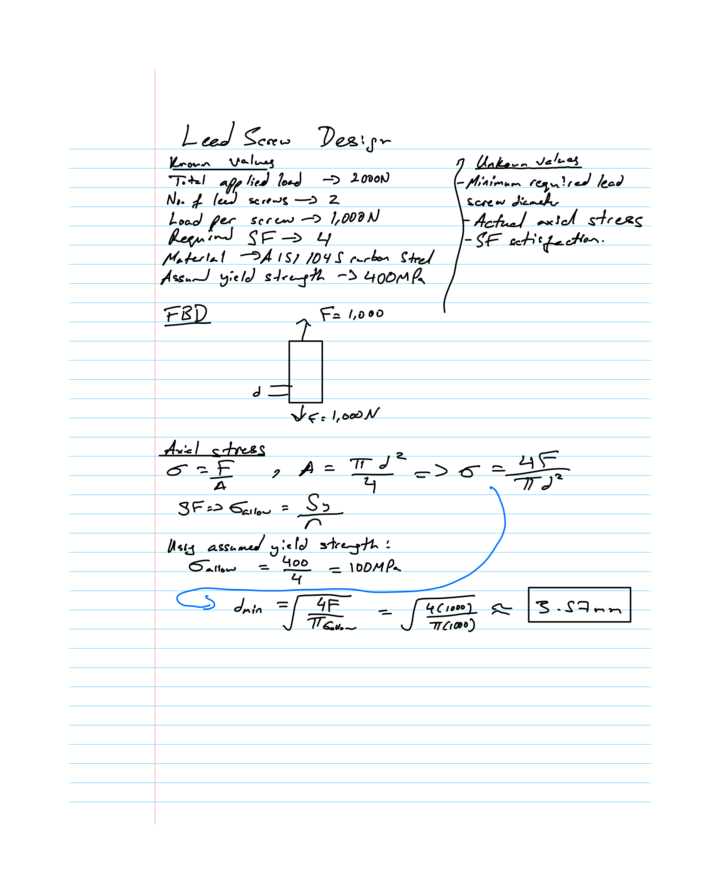

### 1.2 Lead Screw Rotational Speed

The crosshead must travel at speeds ranging from 1 mm/min to 50 mm/min. A preliminary 1/2"-10 single-start lead screw was selected, providing 2.54 mm of linear travel per revolution.

The required rotational speeds were calculated as:

- Minimum rotational speed: **0.394 rpm**  
- Maximum rotational speed: **19.69 rpm**

This establishes the rotational speed range required to achieve the specified crosshead motion.  

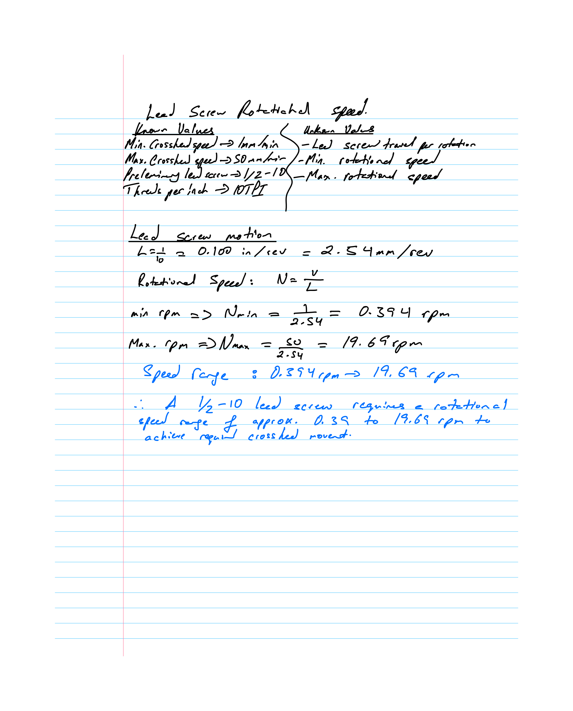

### 1.3 Lead Screw Torque

The torque required to raise the load was determined using the screw's mean diameter, lead, thread geometry and friction.

The calculation assumed a coefficient of friction of 0.15 and an Acme thread half-angle of 14.5°. Each screw carries 1,000 N.

The resulting torque requirements were:

- Torque per lead screw: **1.30 N·m**  
- Combined torque for both screws: **2.61 N·m**

These values represent the estimated torque needed to raise the load through the lead screw mechanisms, excluding additional drivetrain losses.

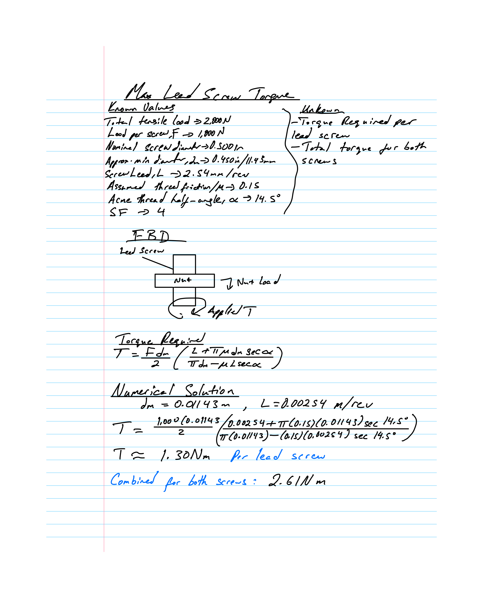

### 1.4 Lead Screw and Flange Nut Selection

Based on the preliminary calculations, the following commercially available components were selected from McMaster-Carr.

**Lead Screw**

- Part number: 93410A112  
- Type: Right-hand Acme lead screw  
- Thread size: 1/2"-10  
- Length: 24 inches  
- Catalog material: Alloy steel  
- Quantity: 2

**Flange Nut**

- Part number: 97790A110  
- Type: Precision Acme flange nut  
- Material: 932 bearing bronze  
- Quantity: 2

The lead screws provide linear motion through rotation, while the flange nuts transfer axial force to the crosshead.

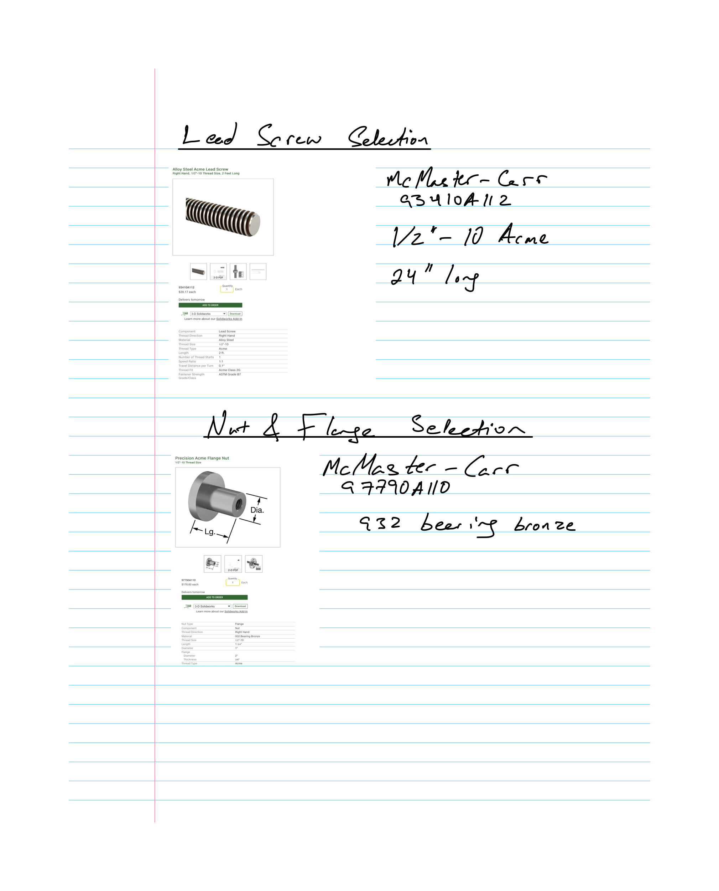

### 1.5 Flange Nut Thread Strength Verification

A preliminary thread bending analysis was performed to evaluate the bronze flange nut under the applied axial load.

The calculation assumed that the first engaged thread carries approximately 38% of the load, along with a conservative bronze yield strength of 14,000 psi.

The analysis produced:

- Maximum estimated thread bending stress: **3,263 psi**  
- Achieved safety factor: **4.29**  
- Required safety factor: **4.00**

The calculated safety factor exceeds the required minimum, supporting the preliminary flange nut selection.  

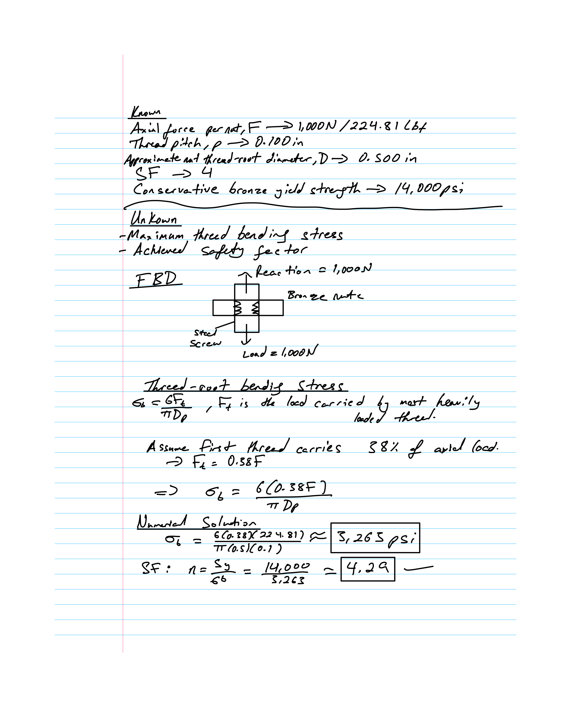

## 2. Crosshead Design

### 2.1 Crosshead Strength Analysis

The crosshead connects the two lead screws and supports the applied load. It was analyzed as a simply supported beam carrying a concentrated load at its center.

The initial design parameters were:

- Maximum applied load: 2,000 N  
- Distance between lead screw centers: 8.00 inches (provisional)  
- Material: 6061-T6 aluminum  
- Estimated yield strength: 35,000 psi  
- Elastic modulus: 10,000,000 psi  
- Required safety factor: 4

Using the maximum bending moment and rectangular cross-section properties, the minimum thickness required for bending strength was calculated as **0.453 inches**.

A preliminary thickness of **0.875 inches** was selected, producing an estimated bending stress of 2,349 psi and an achieved strength safety factor of **14.90**.  

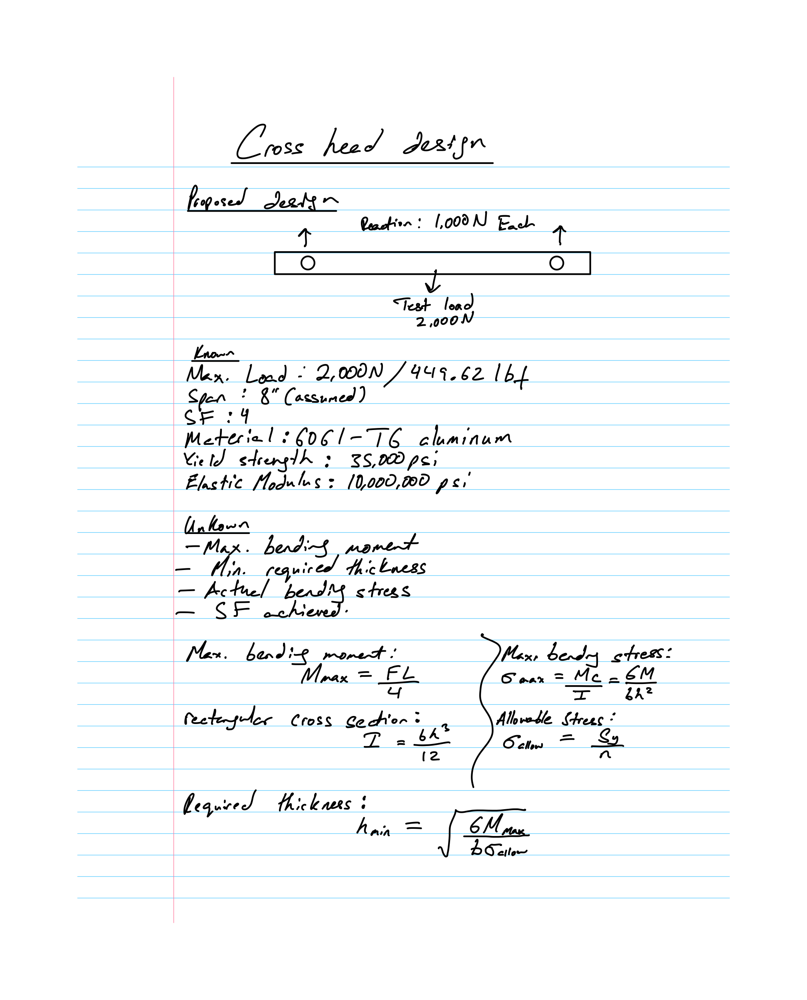

### 2.2 Crosshead Deflection Analysis

In addition to meeting the strength requirement, the crosshead must limit deflection under the maximum applied load.  

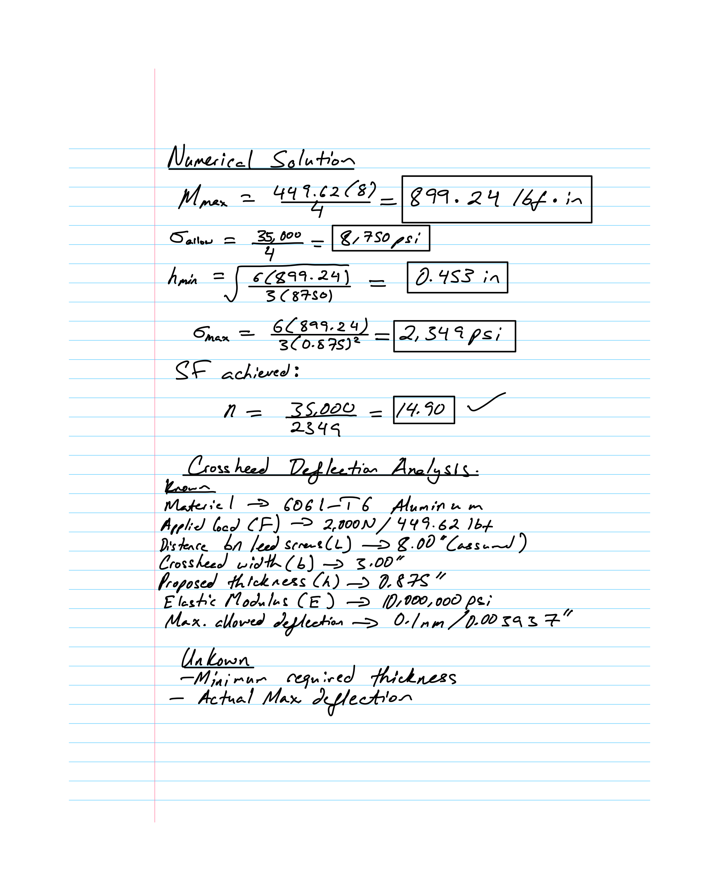

The allowable deflection was specified as 0.10 mm.

Using the beam deflection relationship, the minimum thickness required to meet this limit was calculated as approximately **0.787 inches**.

For the selected thickness of 0.875 inches, the predicted maximum deflection was **0.0727 mm**.

Because the predicted deflection is below 0.10 mm, the preliminary design satisfies the deflection requirement.

### 2.3 Final Preliminary Crosshead Design

After evaluating both strength and deflection, the following crosshead geometry was selected for CAD modeling.

| Parameter | Selected Value |  
|---|---|  
| Material | 6061-T6 Aluminum |  
| Overall length | 11.00 in |  
| Width | 3.00 in |  
| Thickness | 0.875 in |  
| Lead screw center spacing | 8.00 in (provisional) |  
| Calculated strength safety factor | 14.90 |  
| Calculated maximum deflection | 0.0727 mm |  

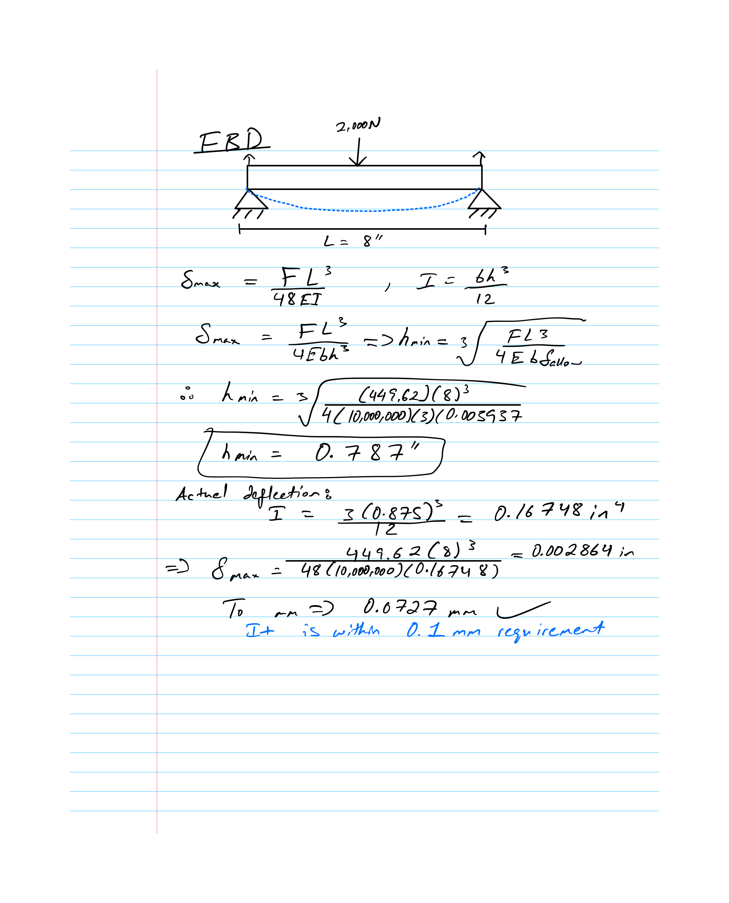

The crosshead incorporates two locations for the lead screw flange nuts, positioned symmetrically about its center.

The selected geometry provides a substantial strength margin while keeping the calculated deflection within the specified limit. The provisional screw spacing will be coordinated with the final frame dimensions.

## 3. Component Cost Estimate

The following table summarizes the lead screws and flange nuts selected for the system.

| Item | Qty. | Component | Unit Cost | Extended Cost |  
|---|---:|---|---:|---:|  
| 1 | 2 | McMaster 93410A112 — Acme Lead Screw | \$39.17 | \$78.34 |  
| 2 | 2 | McMaster 97790A110 — Precision Acme Flange Nut | \$178.60 | \$357.20 |  
| 3 | 1 | Grainger 906T85 — T-Slot Framing System Profiles: Rectangle, 40 Series, Smooth, Double, 2 m Nom Lg, 80 mm x 40 mm | \$143.40 | \$143.40 |  
| | | **Current Component Subtotal** | | **\$578.94** |

**Supplier Links**

- Lead screw: https://www.mcmaster.com/93410A112  
- Flange nut: [https://www.mcmaster.com/97790A110](https://www.mcmaster.com/97790A110)  
- T-slot Framing: [https://www.grainger.com/product/80-20-T-Slot-Framing-System-Profiles-906T85](https://www.grainger.com/product/80-20-T-Slot-Framing-System-Profiles-906T85)

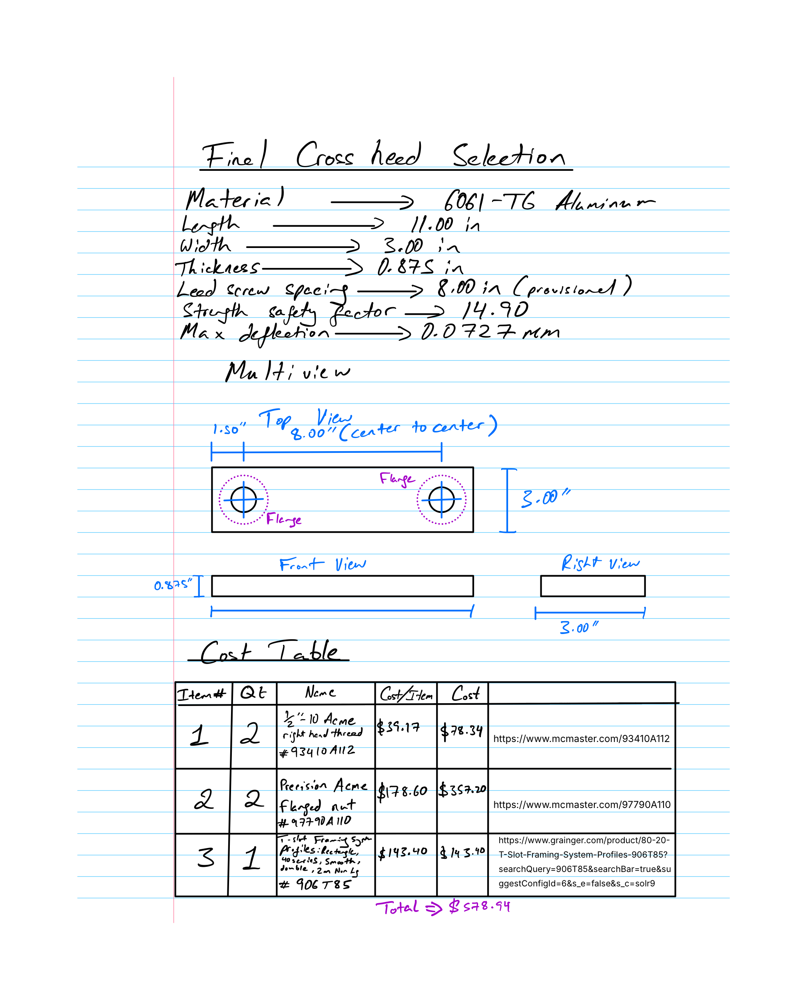

The current subtotal includes only the two lead screws and two flange nuts. The frame selection, associated cost and any additional hardware costs will be incorporated once the remaining component specifications are finalized.

The analytical design establishes the preliminary dimensions, operating requirements and selected components used in the subsequent parametric CAD modeling and structural verification.

## Modeling in CAD

### Parametric Modeling of Crosshead

Jed Miller

Using the dimension calculated by Abdu, we will now model the crosshead. All other components were downloaded from Granger's or McMaster-Carr's website and required minimal processing to get ready for the assembly. Below are the variables and equations used in the parametric design of the crosshead.  

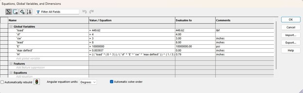

As you can see, the model produces the same minimum height required for the forces applied as Abdu’s work. For the modeling we will be using a height of 0.875”.

Below is the sketch of the crosshead before extrusion. The sketch has identical dimensions to Abdu’s.

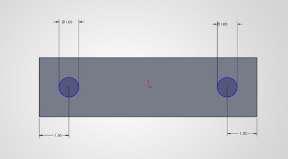

After extrusion, 2 cuts were made to allow the rim of the flange somewhere to rest and present an overall cleaner appearance. 

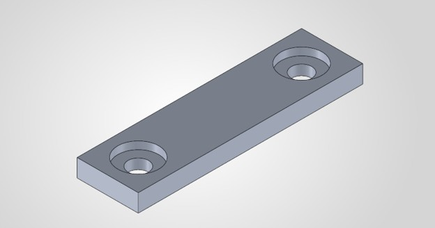

The crosshead was the only component that required any other modeling. The remaining parts were sourced from McMaster-Carr and Grainger and required no additional processing besides cutting the frame material to length. Once the other parts were assembled, we are left with the final assembly below:

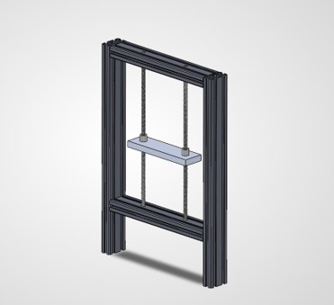

## Crosshead FEA

Jed Miller

### Initial Design

The initial design passed the simulation with flying colors.

Initial Mass: 1140 grams

Maximum von Mises stress: 411.662 psi

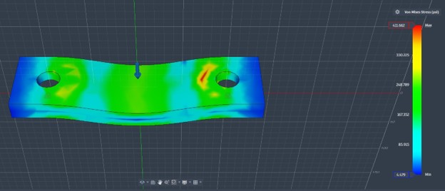

Maximum Displacement: 0.002 mm

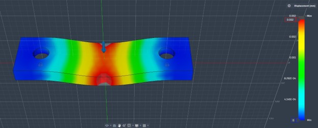

Factor of Safety: 8

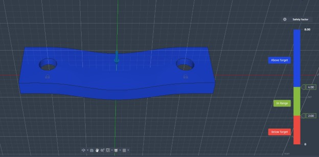

### Optimization Pass

For the optimization I kept the change simple by adding a pocket to the bottom of the crossheader. This removed a little over 60 grams of mass from the design, with minimal change to the safety and functionality of the device.

Mass: 1080

Screenshot of the pocket:

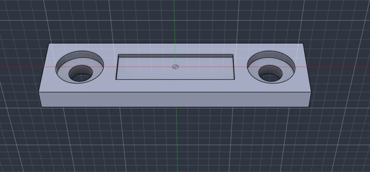

Maximum von Mises Stress: 417.47 psi

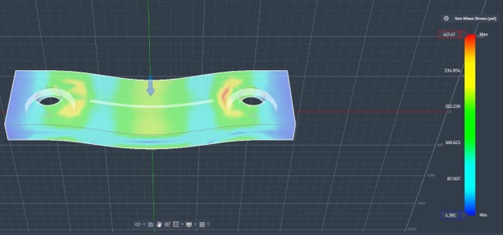

Maximum Displacement: 0.007 mm

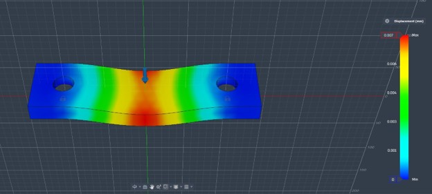

Safety Factor: 8

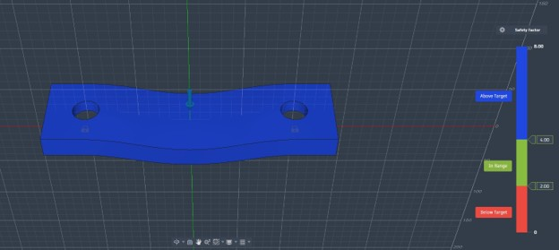

## Crosshead Drawing

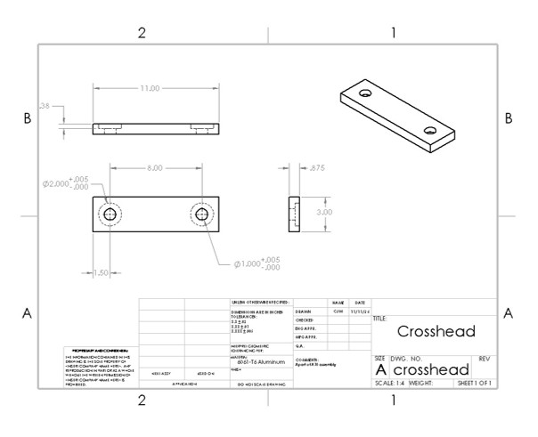

Lessons Learned (Jed):  
This assignment was full of lessons learned. The biggest take away for me was getting the lead screw and flange nut to work together in Solidworks assembly. It took me some time to figure it out but using the mechanical option when mating parts and selecting the screw category made it easy. I also learned that I have an issue in my solidworks account that does not allow me to properly run simulations. This was not a problem, as I was able to download the .step file, import it to Fusion and complete the FEA on the crosshead there. 

Lessons Learned (Abdu):  
I noticed how much engineering calculations influence actual component selection. I realized that meeting the strength requirements alone is not enough. Factors such as deflection, operating speed, torque and compatibility with commercially available components must be considered as well. I also learned coordinating design dimensions with my teammate, since even a small change in one component can affect the entire assembly.

## CAD Files and Deliverables

The complete SolidWorks CAD files for the A10 Lead Screw System Design are available through the Google Drive folder below. The folder contains the modeled components and final assembly for further inspection and modification.

**[View and Download A10 CAD Files — Google Drive](https://drive.google.com/drive/u/1/folders/1KlzRcYmvByLMhT0jpyA3mxplhuxRgRDx)**

## Conclusion

This project provided practical experience in mechanical design, engineering calculations, component selection and teamwork. We evaluated the lead screw system under the specified loading and operating requirements, selected commercially available components and developed a CAD assembly to represent the proposed design.

The project also demonstrated the importance of coordinating analytical calculations with CAD modeling to produce a consistent engineering design.

### Time Spent

**Actual time spent (Abdu):** 5 hours  
**Actual time spent (Jed):**  5 hours
