# A11: Motor Selection Design — Part 2

## Project Overview

This assignment continues our A10 dual-lead-screw tensile tester design. The tester uses two 1/2"-10 Acme lead screws to move the crosshead while supporting a maximum tensile load of **2,000 N**. For A11, we focused on selecting the motors, designing their mounting brackets, connecting the motors to the lead screws, reinforcing the T-slot frame, and adding lower floating bearing supports.

The crosshead must move at **1–50 mm/min**, and the assignment calls for a **factor of safety of 4**. We used our A10 lead-screw calculations as a starting point and continued developing the SolidWorks assembly using a combination of purchased components and custom parts.

This report brings together Abdu's component selections, calculations, and CAD design with Jed's structural FEA, engineering drawings, and final assembly development. Each major section identifies the responsible team member.

## 1. Motor Selection — Abdu Mohamed Abdu

### 1.1 Motor Requirements

The 2,000 N design load is distributed across two lead screws, giving **1,000 N per lead screw**. Our A10 calculation estimated **1.305 N·m** of operating torque per screw. With a safety factor of four, we established a preliminary motor torque target of **5.22 N·m per screw**.

Because the selected 1/2"-10 single-start Acme screw advances 2.54 mm per revolution, the required screw rotational speeds are approximately:

- **Minimum speed:** 0.394 rpm
- **Maximum speed:** 19.69 rpm

The motor must provide sufficient torque across this low-speed range. The calculations and design target are shown below.

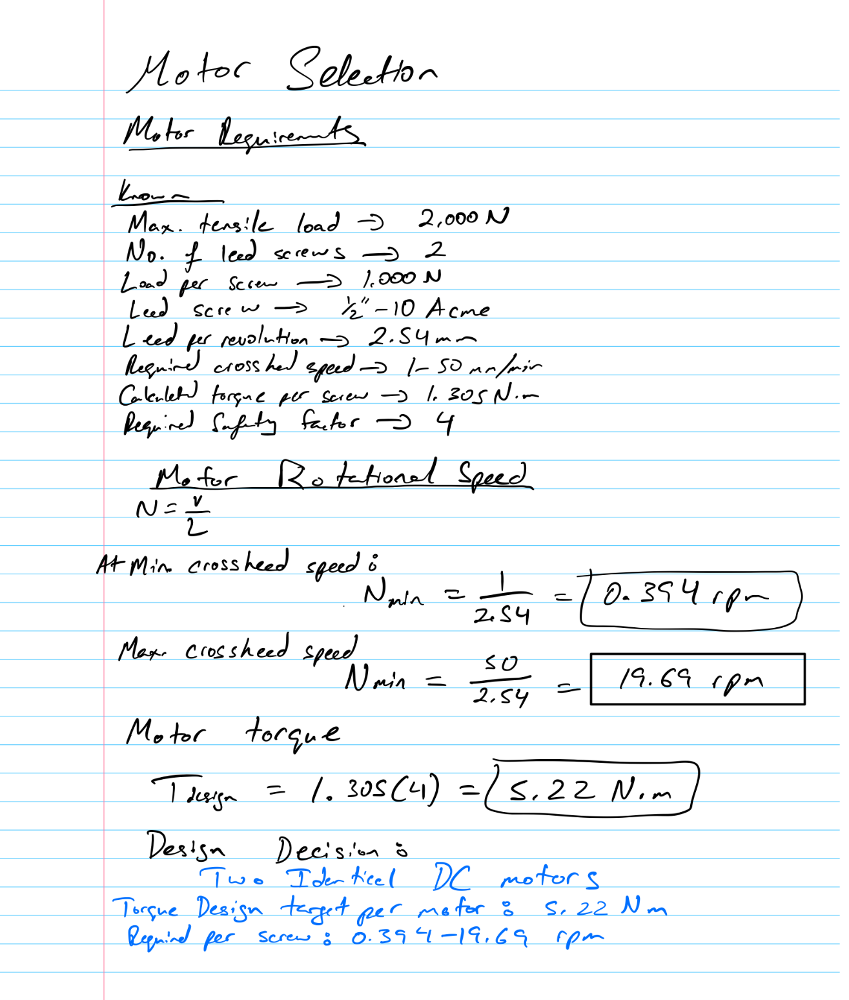

### 1.2 Selected Motor and Gearhead

We selected **two Oriental Motor BLV R Series brushless DC gearmotor systems**, using the 60 W motor, 100:1 gearhead, and compatible driver. The catalog combination is identified by **BLMR460SHK-GFV / GFV4G100 / BLVD-KRD**. Its listed geared output torque is approximately **16 N·m**, above the preliminary **5.22 N·m** torque design target, and its controllable output speed covers our calculated screw-speed range.

The selected package operates from a **24–48 V DC supply**. The supplier's speed–torque curve, rated current, drive efficiency, and exact package variant are important references for final equipment selection. Two independent motors also require synchronization to move the crosshead evenly; controls are outside the mechanical scope of this assignment.

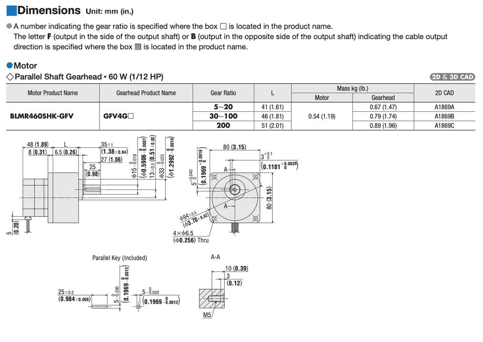

We downloaded the motor's STEP model and imported it into SolidWorks. We measured the mounting interface directly instead of relying only on nominal drawing dimensions.

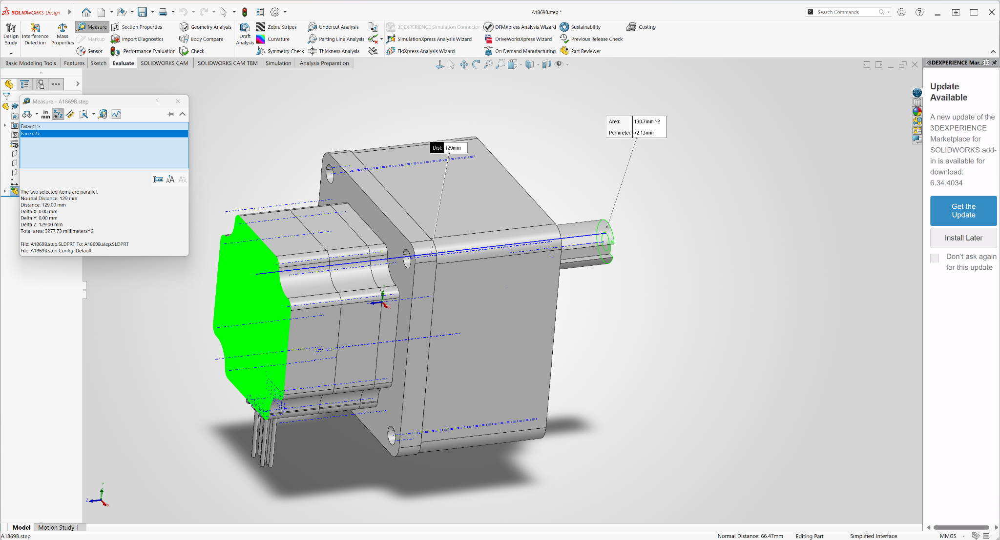

### 1.3 Motor Mounting Interface Measurements

The motor has a nominal **80 × 80 mm** flange, a **Ø15 mm keyed output shaft**, and **four Ø6.5 mm through mounting holes**. The hole pattern was measured at approximately **66.47 × 66.47 mm**.

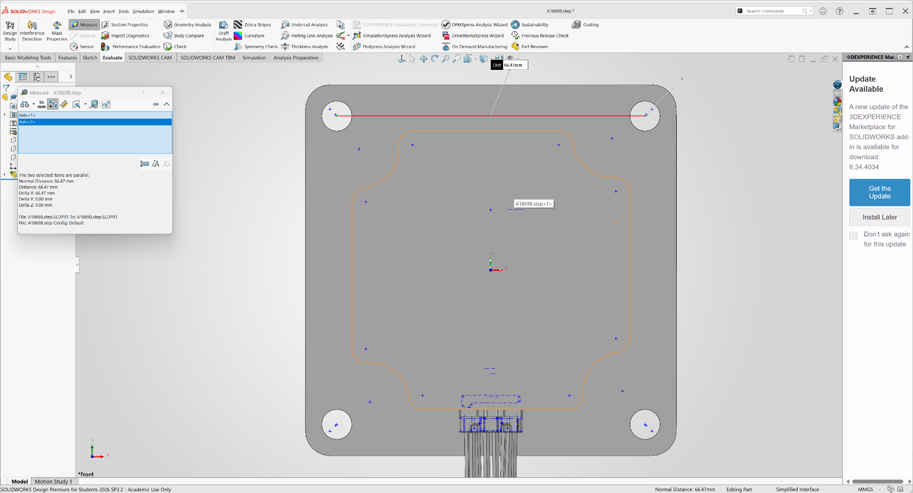

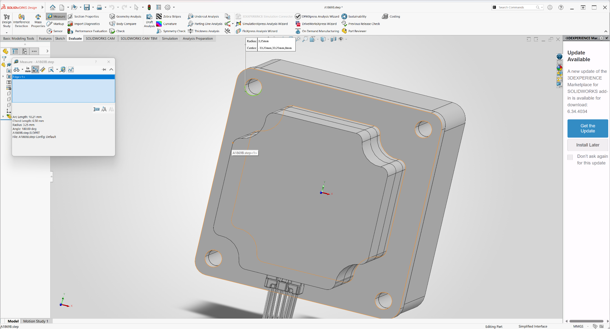

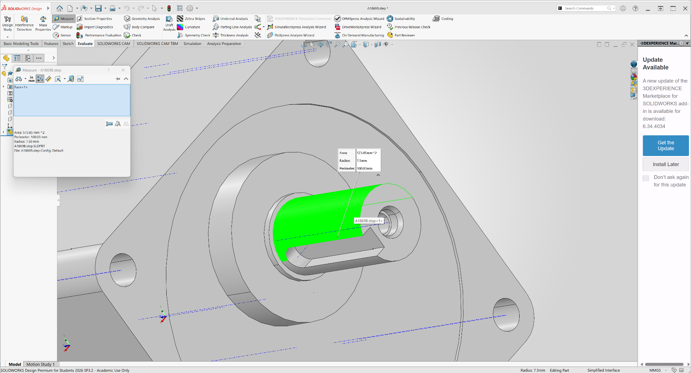

The motor's locating boss is approximately **Ø33 mm**, and the output shaft is not centered within the square bolt-hole pattern. In particular, our measurements showed a **46.23 mm** vertical offset between the shaft axis and one row of mounting holes. This detail became important when mating the motor to the mounting plate.

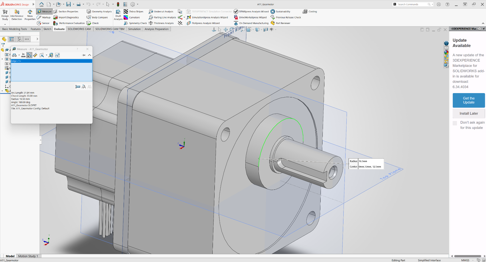

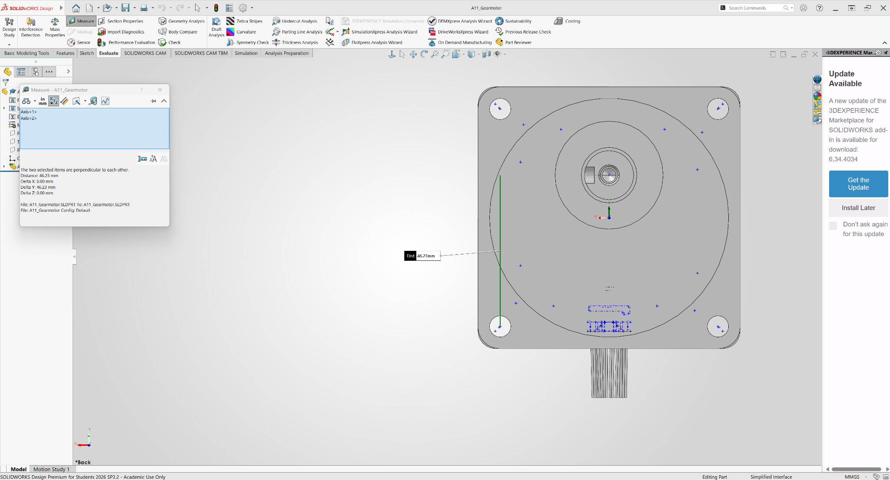

## 2. Motor Mounting Bracket — Abdu Mohamed Abdu

### 2.1 Initial Bracket Design

We designed a rectangular motor mounting plate made of **6061-T6 aluminum**. The plate has the following dimensions and features:

| Feature | Selected dimension |
|---|---:|
| Overall size | 120 × 120 mm |
| Plate thickness | 6 mm |
| Central motor-boss clearance | Ø35 mm |
| Motor mounting holes | 4 × Ø6.5 mm |
| Motor hole spacing | 66.47 × 66.47 mm |

Initially, we centered the bolt-hole pattern on the shaft opening. The original symmetric sketch is shown below.

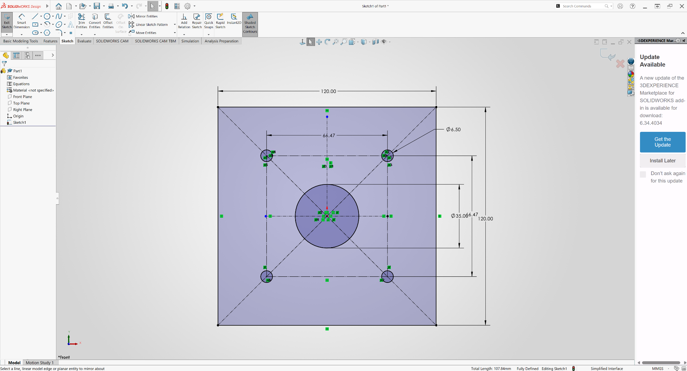

### 2.2 Corrected Motor Mounting Pattern

When assembling the motor and plate, we discovered that the imported motor's output shaft was **offset from the midpoint of its mounting holes**. Our initial sketch caused conflicting assembly mates. We corrected the plate sketch to match the measured offset and retained the four-hole pattern supplied by the manufacturer.

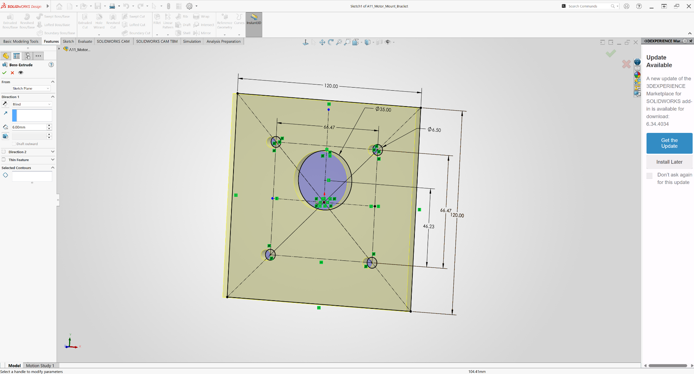

The corrected plate was extruded to **6 mm** thickness and successfully mated to the motor.

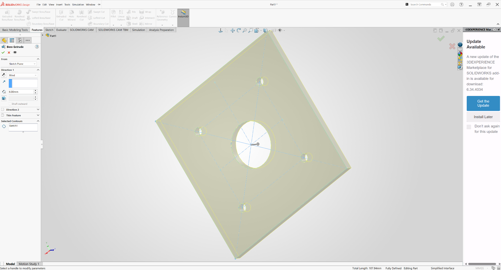

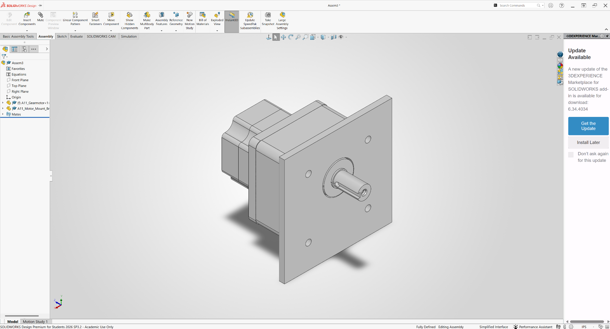

### 2.3 Bearing Stress and Minimum Thickness

The bracket thickness was checked using a simplified bearing-stress model at the four motor mounting holes. We used the motor's **16 N·m** rated output torque, nominal **M6** fasteners, a conservative assumed **240 MPa** yield strength for the aluminum, and a safety factor of four.

The approximate bolt-group radius is **47.0 mm**. Under an equal-load-sharing approximation, the motor reaction torque produces an estimated **85.1 N** of tangential force at each bolt. Our resulting preliminary values were:

- **Allowable bearing stress:** 60 MPa
- **Calculated minimum thickness:** 0.236 mm
- **Selected thickness:** 6.0 mm
- **Estimated bearing stress at 6 mm:** 2.36 MPa

The free-body diagram, symbolic work, and numerical solution are shown in our handwritten notes.

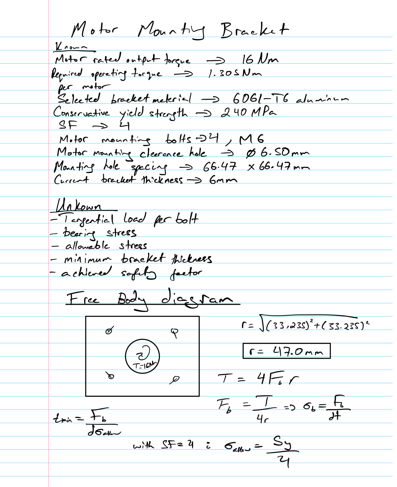

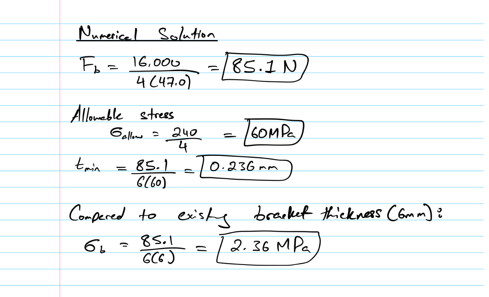

The calculated local hole-bearing stress is below the assumed allowable stress. **This is a preliminary check**, not a full verification of plate bending, deflection, eccentric bolt loading, bolt preload, or the frame-side joint. The separate four-hole attachment pattern that secures the plate to the T-slot frame must be finalized alongside Jed's top-frame modifications.

## 3. Coupler Selection and Torsion Analysis — Abdu Mohamed Abdu

### 3.1 Coupler Selection

We selected **two Ruland MSPC-15MM-1/2-F two-piece rigid keyed shaft couplers**, one for each motor and lead screw. The motor-side bore is **15 mm** and the lead-screw-side bore is nominally **1/2 inch (12.7 mm)**. The selected coupler is approximately **34 mm in outside diameter** and **50 mm long**, with a listed torque rating of **200 N·m**.

The two-piece design can be assembled around the shaft ends and provides access to its clamping fasteners. The rigid arrangement requires careful shaft alignment. The lead screw's existing Acme thread is **not a finished keyed journal**, so the top shaft-end interface or adapter must be resolved before a physical build.

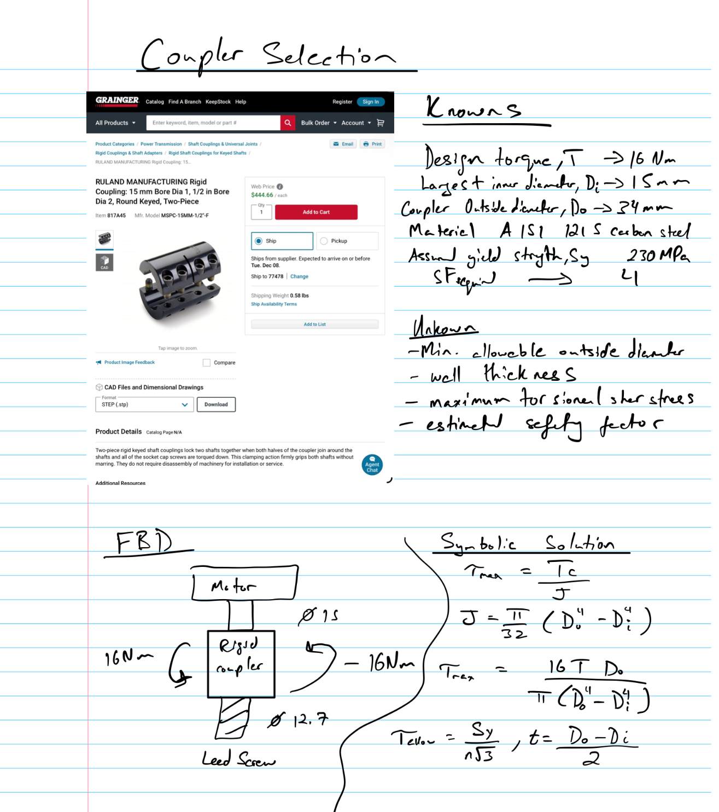

### 3.2 Torsional Shear and Thickness Check

For a preliminary torsional analysis, we represented the coupler as an ideal hollow circular steel section. We assumed **AISI 1215 carbon steel**, a **230 MPa** representative yield strength, a **16 N·m** applied torque, and a factor of safety of four.

The analysis produced:

| Result | Value |
|---|---:|
| Allowable shear stress | 33.20 MPa |
| Theoretical minimum outside diameter | 17.49 mm |
| Theoretical minimum radial wall | 1.245 mm |
| Selected outside diameter | 34 mm |
| Selected nominal radial wall (motor side) | 9.50 mm |
| Estimated shear stress in ideal annular section | 2.155 MPa |
| Estimated idealized material safety factor | 61.6 |
| Catalog torque rating | 200 N·m |

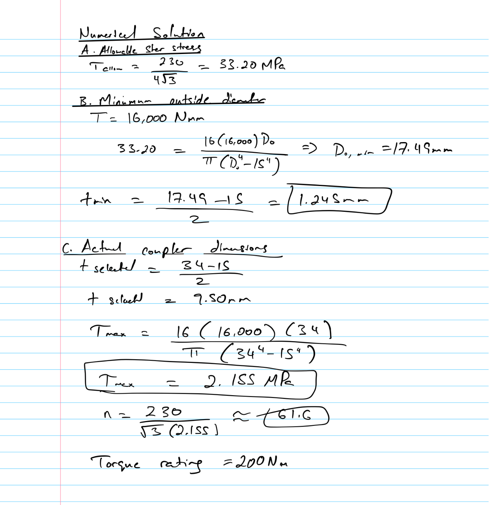

The catalog rating exceeds the motor's rated torque by a factor of **12.5**. Our simplified annular calculation does **not** include the split line, keyways, clamp fasteners, shaft grip, or fatigue. These interface details must be checked separately during final integration.

## 4. Top Frame Connector Analysis — Abdu Mohamed Abdu

### 4.1 Connector Selection

To improve the connection between the upper crossmember and the two vertical T-slot members, we selected reinforced inside-corner connectors. Our preliminary choice is the **80/20 40-4338 gusseted eight-hole inside-corner bracket**, compatible with the **40 Series, 40 × 80 mm** frame profile.

The proposed layout uses **two brackets at each upper corner**, for a total of **four connectors**. The exact locations must be matched to the available T-slots and the final top-frame arrangement.

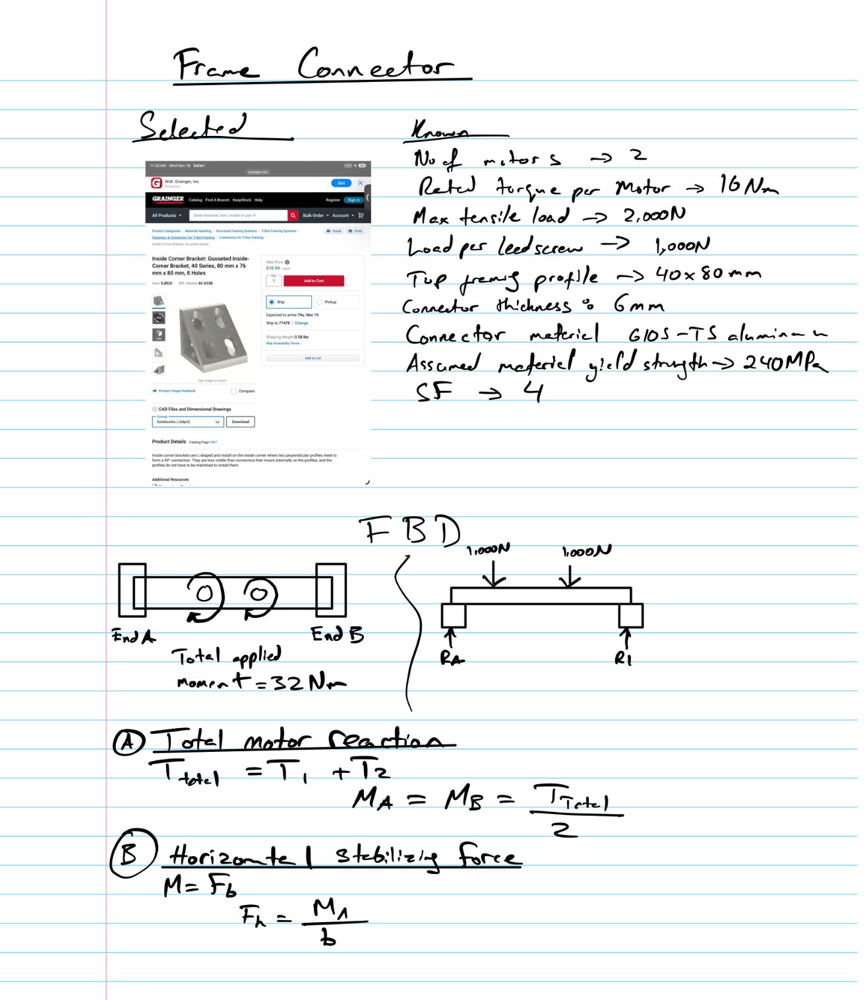

### 4.2 Motor Reaction and Frame-End Forces

Two motors can impose a combined reaction torque of **32 N·m** when both are loaded at their rated **16 N·m** torque in the same direction. Assuming symmetric frame connections, we estimated a **16 N·m** reaction moment at each upper frame end.

Using a provisional **40 mm** separation for the resisting force couple and two brackets per corner, we estimated:

- **Horizontal stabilizing force per opposed bracket:** 400 N
- **Vertical reaction at each frame end:** 1,000 N
- **Vertical force per bracket:** 500 N
- **Resultant force per bracket:** 640.3 N

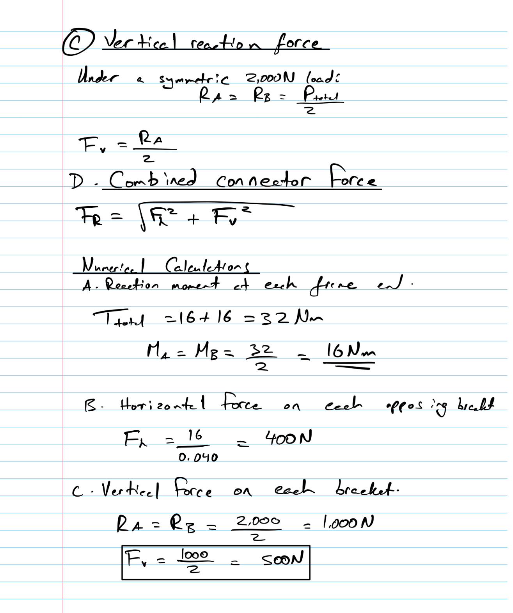

### 4.3 Preliminary Connector Bearing-Stress Check

With a nominal **M8** bolt and a **6 mm** gusset bracket thickness, the simplified local bearing-stress estimate was **13.34 MPa**. Using the assumed **240 MPa** material yield strength and factor of safety four gives a **60 MPa** allowable stress.

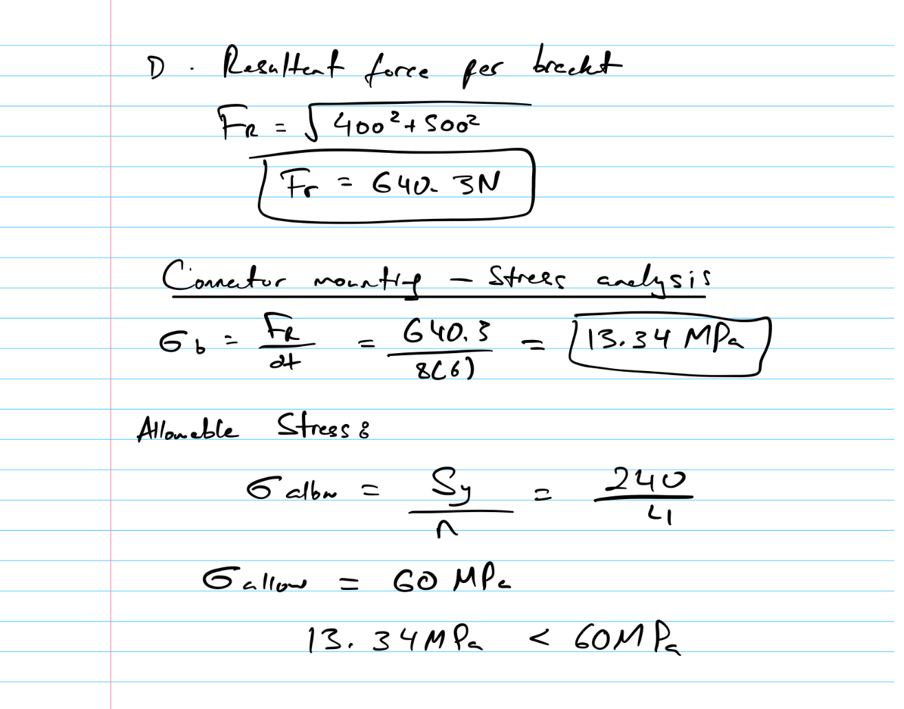

Because the estimated stress is less than the allowable value, the connector is a reasonable **preliminary selection**. This check does not establish complete joint strength or stiffness: connector bending, T-nut engagement, slot pullout, fastener preload, and the actual moment lever arm still require verification. Jed's top-frame and vertical-frame FEA are documented in Sections 5 and 6.

## 5. Top Crossmember FEA — Jed Miller

### 5.1 Model and Boundary Conditions

The top crossmember was analyzed with the motors and lead-screw system represented in the finite element model. The applied loads and constraints used for this study are summarized below.

**Forces applied:**

- **1 kN axial compression force** applied at each motor location.
- **8 N·m moment** applied at each motor location.

**FEA setup and mesh:**

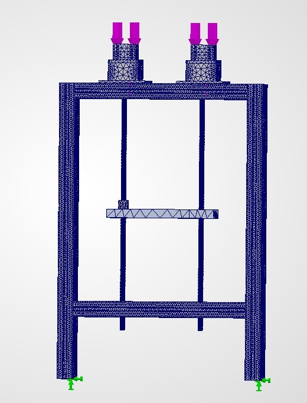

### 5.2 Stress, Displacement, and Safety Factor

**Von Mises stress:**

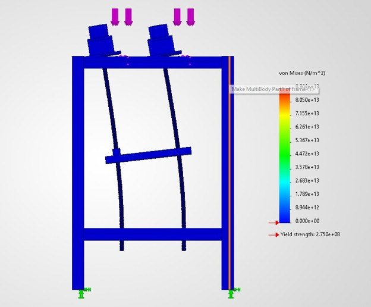

**Displacement:**

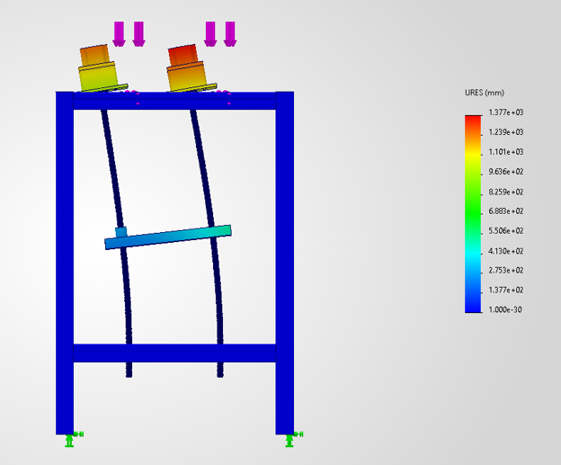

**Factor of safety:**

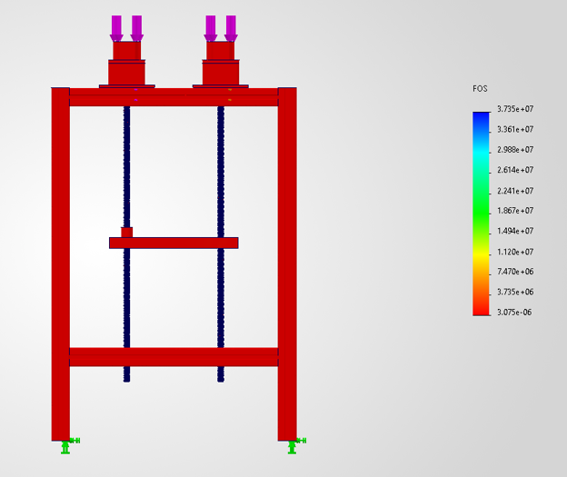

### 5.3 Frame Optimization

Some modifications that can be made to the model would include reinforcement around the motor insertion points. These regions should be reconsidered when finalizing the motor mounting arrangement and interpreting the simulation results.

## 6. Vertical Frame FEA — Jed Miller

### 6.1 Vertical Member Analysis

The upright members were evaluated under combined axial and transverse loading to examine frame deformation and stresses.

**Forces applied:**

- **2 kN axial compression force** applied to the center of the top of the frame.
- **2 kN transverse load** applied to the frame.

**FEA setup:**

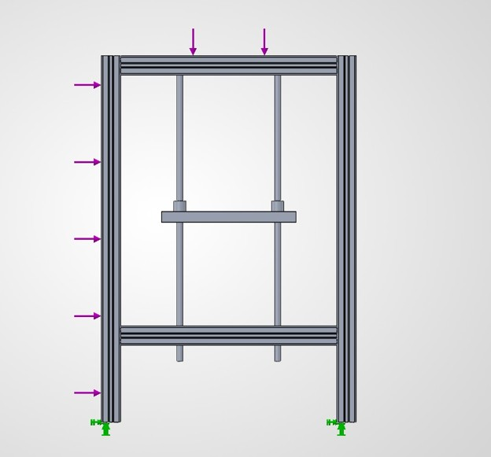

### 6.2 Results and Optimization

**Von Mises stress:**

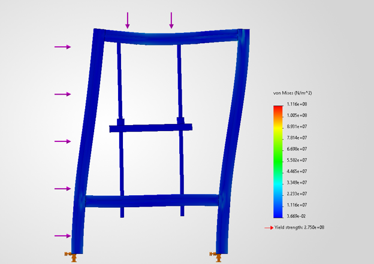

**Deformation:**

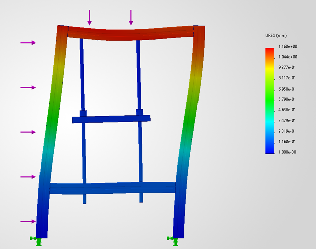

**Factor of safety:**

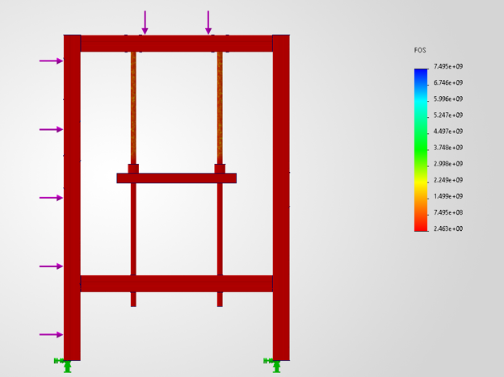

**Optimization:** Angled brackets can be added to the interior corners of the design to add strength and rigidity to the frame.

## 7. Floating Bearing Mount Design — Abdu Mohamed Abdu

### 7.1 Purpose and Bearing Selection

The lower floating supports help keep the two lead screws aligned while allowing them to **rotate** and accommodate limited **axial movement**. Each support limits lateral movement at the bottom of a lead screw without becoming the primary axial-load reaction point. A separate fixed/thrust-bearing arrangement is required to transfer the screw's main axial load into the frame.

We selected a commercially available **Oilite AAM0812-12 bronze sleeve bushing** for each lead screw. The nominal bushing dimensions are **8 mm inside diameter, 12 mm outside diameter, and 12 mm length**. The material is self-lubricating sintered bronze impregnated with synthetic lubricant; in SolidWorks, ordinary bearing bronze was used only as an approximate material assignment.

The manufacturer's drawing specifies a free bore of **8.010–8.030 mm**, an outside diameter of **12.030–12.050 mm**, and a length of **12.000 ± 0.127 mm**.

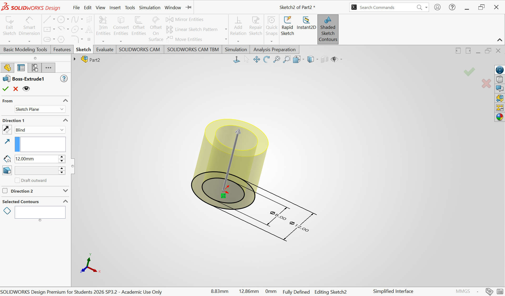

### 7.2 Aluminum Mounting Block

We modeled two matching **6061-T6 aluminum mounting blocks**, each measuring **60 × 40 × 20 mm**. Each has a centered, nominal **Ø12 mm blind pocket, 12 mm deep**, to receive the bushing. Two **Ø6.6 mm** through-holes are spaced **36 mm** apart for proposed M6 fasteners and T-slot nuts at the lower crossmember.

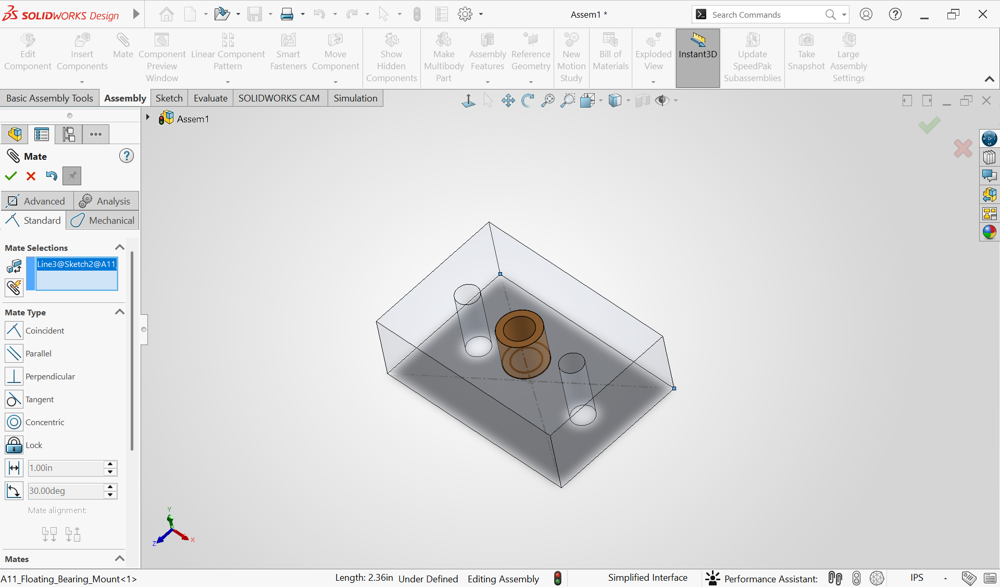

### 7.3 Modified Lead Screw Journal and Assembly

The existing Acme screw has a nominal outside diameter of **12.7 mm**, which cannot fit into the bushing's **8 mm** opening. Instead of running the threads directly against the bearing, we added a **smooth nominal Ø8 mm journal, approximately 15 mm long**, to the bottom end of each lead screw in the CAD model. The upper end remains reserved for the motor coupling connection.

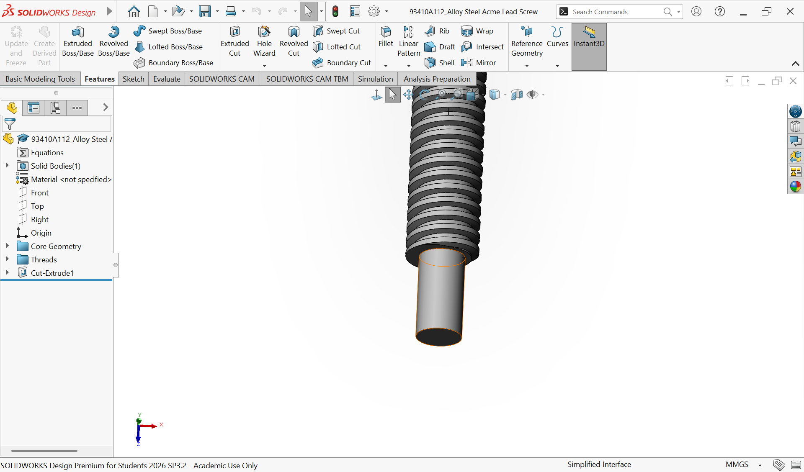

We inserted both floating-bearing subassemblies into the main SolidWorks tester assembly, aligned the bushings with the modified screw ends, and positioned the mounts on the existing lower T-slot crossmember. The earlier holes used for the lead screws in the lower frame were removed from the CAD model.

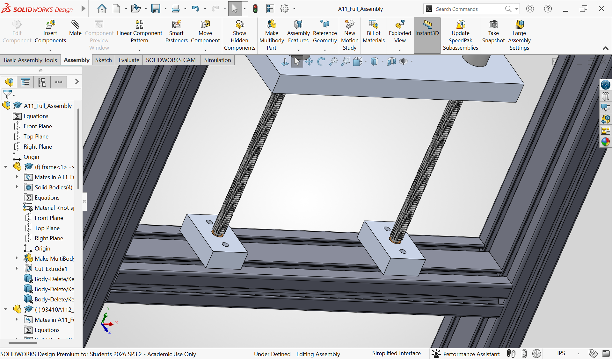

### 7.4 Fit, Clearance, and Remaining Verification

Our **Ø12.00 mm** pocket and the bushing's **12.030–12.050 mm** outside diameter produce a nominal interference before installation. However, pressing in a sintered bronze bushing can change its installed bore size. The selected journal's **Ø8 mm CAD dimension is nominal only**; the exact shaft tolerance and required **RC3 running fit** remain to be specified from the relevant fit table and checked after installation.

Before fabrication, we would also verify that the journal does not bottom out in the blind housing, the Acme threads remain outside the bushing, and both mount bolt holes reach accessible T-slots. We intentionally kept this section simple and prioritized completing the functional assembly model.

## 8. Bill of Materials and Engineering Cost — Abdu and Jed

This preliminary list records the A11 components selected or modeled. Some component quotes, machining costs, and fastener quantities still require confirmation. The assignment specifies **$35 per hour** for engineering labor.

| Item | Qty. | Component / Specification | Cost Status |
|---|---:|---|---|
| 1 | 2 | Oriental Motor BLV R 60 W gearmotor, 100:1 gearhead and matching driver | Confirm supplier price |
| 2 | 2 | Custom 6061-T6 motor mounting plate, 120 × 120 × 6 mm | Estimate fabrication |
| 3 | 2 | Ruland MSPC-15MM-1/2-F rigid keyed coupler | Confirm supplier price |
| 4 | 4 proposed | 80/20 40-4338 gusseted frame connector | Confirm quantity and price |
| 5 | 2 | Oilite AAM0812-12 bronze sleeve bushing | Confirm supplier price |
| 6 | 2 | Custom 6061-T6 floating mount, 60 × 40 × 20 mm | Estimate fabrication |
| 7 | As needed | Frame mounting bolts, T-nuts, washers and other fasteners | Finalize during assembly |
| 8 | As needed | Modified upper frame, supports, shaft ends and thrust-bearing hardware | Coordinate with Jed |
| 9 | Actual hours | Engineering labor at $35/hour | Complete time record |

**Engineering labor:** Abdu recorded **9 hours** and Jed recorded **8 hours**, for a combined **17 hours**. At **$35/hour**, the calculated engineering labor cost is **$595**, excluding materials and fabrication. The final purchased-part and manufacturing subtotal remains pending verified supplier and fabrication quotes.

## 9. Modeling and Assembly Integration

### 9.1 Motor and Bracket Subassembly — Abdu

The motor STEP model was imported into SolidWorks and attached to the custom mounting plate. Correcting the offset bolt-hole geometry was necessary to eliminate the initial mating conflict. The final component arrangement keeps the Ø15 mm motor shaft concentric with the central clearance opening.

The motor-and-plate CAD model is shown in **Image 18** above.

### 9.2 Frame and Lower Bearing Subassemblies — Abdu

The selected frame connectors and floating bearing supports were added to the A11 full assembly. Both lower bearing blocks are aligned under the two Acme lead screws. The frame-side fasteners and upper motor/coupler connections remain subject to the final team model.

The completed lower-support arrangement is shown in **Image 13** above.

## 10. Drawings

The following drawings document the motor mounting bracket, A10 crosshead, lower floating bearing mount, and overall tester assembly.

### Motor Mount Bracket

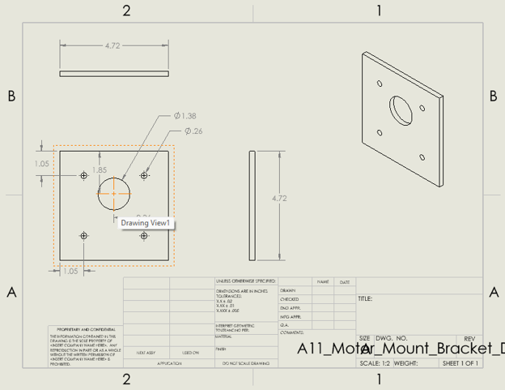

### Crosshead

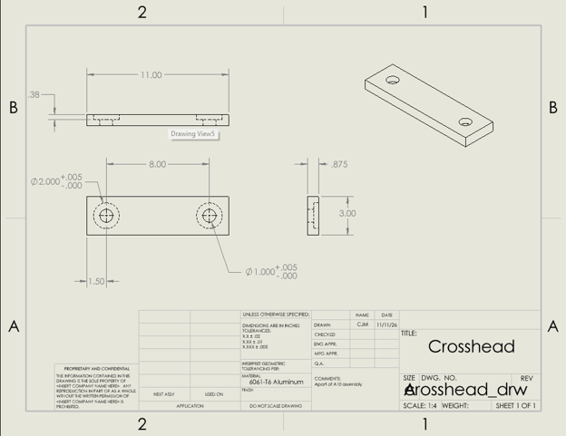

### Floating Bearing Mount

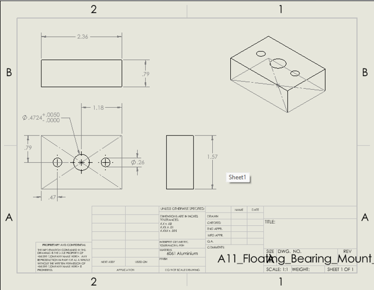

### Full Assembly

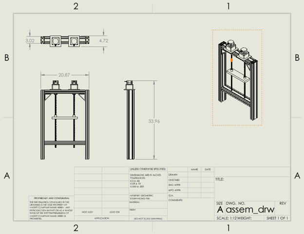

## 11. Lessons Learned

### Abdu Mohamed Abdu

This assignment demonstrated how important it is to verify dimensions from actual manufacturer models. During the motor bracket design, I initially assumed that the shaft was centered in the mounting-hole pattern. Measuring the imported gearmotor corrected that assumption and allowed us to mate the parts properly. I also learned that a coupler can pass a simplified torsional strength check while still requiring careful attention to the shaft-end geometry and connection method. Finally, designing the floating support helped me understand the difference between radial bearing support and the axial restraint that must be provided elsewhere in the machine.

### Jed Miller

Challenges that occurred throughout the assignment included difficulty getting specific features downloaded from McMaster and Grainger to mesh and function appropriately in the study, as well as unfamiliarity with SolidWorks leading to over-constraining parts and making the assembly FEA difficult. Using online resources and consulting with industry professionals helped alleviate some of these issues.

## 12. CAD Files and Deliverables

The working SolidWorks models include the imported gearmotor, custom mounting plate, two rigid couplers, 40 Series frame connectors, bronze bushings, custom lower bearing mounts, modified Acme screw-end journals and the full A11 assembly. The final CAD download folder must be added before submission.

[View and Download A11 CAD Files — Google Drive](https://drive.google.com/drive/folders/1D5WJgKQ31YWaRp5UHwt8apPpOH9SMufp?usp=sharing)

## 13. Conclusion

The current A11 work establishes a motorized-drive concept and preliminary structural integration for the dual-lead-screw tensile tester. We selected geared motors, analyzed motor and frame connections, selected a commercial shaft coupling and modeled the lower floating supports. Our calculations guided component sizing, while SolidWorks exposed several fit and assembly details that were not obvious from nominal catalog dimensions. The FEA, frame modifications, drawing work and our combined cost estimate complete the final team portfolio.

### Time Spent

**Actual time spent (Abdu):** 9 hours  
**Actual time spent (Jed):** 8 hours  

## Component References

- **Selected gearmotor:** [Oriental Motor BLV R Series](https://catalog.orientalmotor.com/item/blv-r-series-brushless-dc-motor-speed-control/shop-blv-r-series-brushless-dc-motors/blmr460shk-gfv-gfv4g100-blvd-krd)
- **Selected rigid coupler:** [Ruland product listing](https://www.grainger.com/product/RULAND-MANUFACTURING-Rigid-Coupling-15-mm-Bore-817A45)
- **Upper frame gusset connector:** [80/20 product listing](https://www.grainger.com/product/80-20-Inside-Corner-Bracket-Gusseted-5JRU3)
- **Oilite AAM0812-12 bushing:** [Oilite manufacturer](https://oilite.com/product/AAM0812-12)
- **Acme lead screw:** [McMaster-Carr 93410A112](https://www.mcmaster.com/93410A112)
- **Flange nut:** [McMaster-Carr 97790A110](https://www.mcmaster.com/97790A110)
